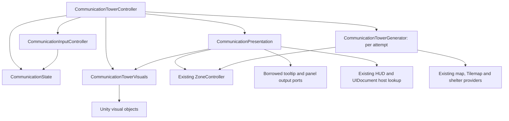

# CommunicationSystem — Stage C3: Visuals, Input and Presentation Extraction

Date: 2026-10-23. Completed as one implementation stage. Three internal plain C# helpers now own rendering, pointer interpretation and presentation; CommunicationTowerController remains the sole public MonoBehaviour. Its 17 public signatures, 24 Inspector fields and script GUID are preserved. The C2 state/generator files remain unchanged. Before/after managed runs pass 303 assertions and match all 99 captured states/traces. Runtime compilation passes with zero errors and the same 11 warnings. PlayableTilemap is unchanged; the user's existing Dev_UINavigation deletion remains intact. Unity-native rendering, import and Play Mode were not verified by this stage.

## 1. Files changed and created

Only previously existing file modified:

- `Assets/Game/Features/MitigationFeatures/Communication/CommunicationTowerController.cs` — forwards rendering/input/presentation work to helpers and binds existing UI output methods.

New helpers:

- `Assets/Dev/Dev_CommunicationSystem/Dev_CommunicationTowerVisuals.cs`
- `Assets/Dev/Dev_CommunicationSystem/Dev_CommunicationInputController.cs`
- `Assets/Dev/Dev_CommunicationSystem/Dev_CommunicationPresentation.cs`

Each helper has new metadata using the existing Dev naming/metadata conventions and a fresh GUID. This report and its metadata are also new. No existing metadata was modified.

At entry, Dev_UINavigation.unity and its `.meta` were already deleted. They were not restored, recreated, edited or run. Existing changes to the font asset, PlayableTilemap, layouts and the prior C1/C2 work were retained. No other production source, scene, prefab, UI asset, map data or project setting changed.

## 2. Methods and responsibilities extracted

| Helper | Extracted work and owned data |
| --- | --- |
| `CommunicationTowerVisuals` | `SpawnTowerVisual`, `UpdateTowerVisual`, `GetSpriteForTower`, `ClearTowerVisuals`, `SetTowerVisualsVisible`; tower GameObject/renderer dictionaries and the missing-sprite diagnostic flag. |
| `CommunicationInputController` | Mouse screen sampling, `TryGetTowerUnderMouse`, camera/world/cell conversion and left-button intent. Receives the existing state lookup and returns a PointerSample; holds no tower collection or hovered target. |
| `CommunicationPresentation` | Hover-target comparison/storage, old/new target presentation, associated-zone requests, communication-only cleanup, tooltip host resolution/configuration/show/hide, panel-show requests and outline-failure diagnostic state. |

Private forwarding methods remain on the controller where they preserve existing orchestration call sites. They do not retain duplicate rendering dictionaries, hover state, input processing or outline/tooltip implementations. The controller still resolves scene references and creates the same optional tooltip/root fallback objects at the original call points.

Visual Settings and presentation Context are transient argument bundles, not serialized fields or independent gameplay/visual state models. Settings are read for the existing spawn/update operations; scale/height/sorting are applied only at spawn. Repeated same-target hover refreshes the tooltip without refreshing renderers or retrying outlines.

## 3. Final helper dependency graph



The controller owns one state, visuals, input and presentation instance. Generator construction remains per attempt, exactly as in C2. Presentation borrows the same visuals instance; it does not construct another renderer/helper or authoritative state store. Input uses the existing state's cell lookup.

Presentation does not discover or retain CommunicationTowerController, MapHoverTooltipController or CommunicationPanelController. The composition root supplies narrow output callbacks, including the existing tooltip status-provider binding and panel ShowForTower method. The controller caches tooltip method bindings by target identity to avoid recreating delegates each hover frame; it does not cache Inspector settings or document values there. Presentation borrows these ports per call and retains only hovered tower plus its outline diagnostic flag. Existing UI controllers continue to query the public facade through their unchanged contracts.

There are no helper-to-owner gameplay calls, helper lifecycle callbacks, event subscriptions, new singletons, global buses or circular helper dependencies. The existing GlobalHUD singleton is only read for the original tooltip-host fallback.

## 4. Controller responsibilities remaining

The five Unity lifecycle methods, generation retry coroutine, reference resolution, provider validation, public queries/events, mode changes, activation/warning ordering and regeneration coordination remain on the original MonoBehaviour. All **24 retained controller method bodies** compare byte-for-byte with C2, including Awake/Start/Update/OnDisable/OnValidate, generation/retry, activation, warning, mode methods and scene resolution. Moved operations are reached through private forwarding/composition methods.

The controller alone schedules input in Update: first pointer/hover presentation, then left-button intent and activation. Click intent is deliberately sampled after tooltip processing, rather than bundled eagerly into the earlier pointer sample. A null hovered tower still short-circuits button polling.

Activation remains: mark active → update visuals → apply Pending transitions → synchronous OnTowerActivated → panel open. Repeated selection opens the panel without another activation event. The entire C2 ActivateTower method body is unchanged.

## 5. Visual comparison results

Managed comparisons verify:

- Identical `CommunicationTower_{towerId}` names, existing root identity, SetParent(false), world positions with y offset, local scale, sorting layer/order and colors including alpha.
- All four main/zone sprite assignment combinations, both sprite fallbacks, empty placeholders and one missing-sprite warning per helper/controller lifetime, including across regeneration.
- Hover color taking precedence over inactive/active colors; activation sprite changes; hover exit restoring the current active color.
- Startup policy, mode-on visibility and active towers remaining visible when inactive towers are hidden.
- Changed colors used at visual update, existing scale/sorting unaffected by those updates, and new scale/height/sorting used on the next spawn.
- Same clear order and exactly one destruction request per prior tower GameObject during regeneration. The helper calls `UnityEngine.Object.Destroy`, preserving the original native deferred-destruction API; it does not introduce DestroyImmediate or eager native destruction.

The stand-in engine performs simplified destruction internally. Matching requests and source API establish extraction parity; actual Unity frame-end destruction remains a native check.

## 6. Input comparison results

The helper preserves the legacy UnityEngine.Input implementation and the same screen→world→cell→state lookup. No UI pointer blocker, raycast, input action, mode exclusion, extra click restriction or independent input scheduler was added.

Instrumented assertions/traces verify:

- Same pointer reads, one camera conversion per eligible hit lookup, world z forced to zero before cell conversion and one left-button poll for a hovered tower.
- Hover/tooltip processing before button sampling. A fixture that changes button intent during tooltip display still activates on that frame in both C2 and C3.
- Same repeated-selection behavior and exactly one activation event.
- Missing camera/Tilemap producing no hit, no button poll and no input-time fallback search.
- Communication mode remaining active with failed generation while input continues to find no tower.

Native camera projection and real input scheduling were not executed; managed fixtures check the parameters, sequencing and results passed through the actual controller/helper sources.

## 7. Presentation comparison results

Presentation replaces/clears **CommunicationZones** only. It creates no outline renderer, zone cache or Tilemap. Managed checks use the actual ZoneController/ZoneIndex/geometry/outline-renderer source with engine stand-ins.

Checks pass for same-target tooltip refresh; old/new target color restoration; failed-outline warning state; no retry on the same hovered target after renderer recovery; successful retry after changing targets; and resetting the outline-failure diagnostic flag only after an accepted request.

Other channel geometry, cached counts and requested visibility remain intact. Existing zone visibility policy still applies: ZoneOutlineRenderer can suppress persistent visibility when any persistent channel is shown under the current policy. The fixture applies that policy before populating the other channels, then verifies communication changes do not independently clear/replace them. No new policy writer or channel override was introduced.

Tooltip checks preserve document→status-source→debug configuration order, communication show/hide calls, GlobalHUD preference, marker-based fallback including inactive documents, reuse of the shared tooltip target, and communication-only hiding. A simulated evacuation tooltip on the same host survives communication hover/cleanup. If another consumer changes the shared host, the next communication show reuses the controller's existing document/configuration, just as C2 does. Actual UI Toolkit root cloning, positioning and pointer picking remain inside the unchanged MapHoverTooltipController.

Panel checks preserve reference fallback at the controller's original scene-resolution point, ShowForTower object identity, event-before-panel timing, reopening an active tower, mode retention, and a warning for each missing-panel attempt. Presentation invokes a supplied panel output method; warning selection, tab population, population arithmetic, sprites and button callbacks remain entirely in the unchanged panel controller.

## 8. Gameplay and event regression results

The captured C2 controller baseline SHA-256 is `cf0466eb607d9cfb7ccc99f8c8aea053462aa38833dbe2f74b6c296f4aba97e5`. Tests run that captured source against C3, rather than assuming older C1 source or historical test results are the current baseline.

The 215 existing managed checks still pass, covering ordered tower IDs/cells/world centers/GEOIDs, grouping and scoring, water/shelter exclusion, origins, state transitions, query reference/copy semantics, synchronous events, repeated mode calls, zero-tower success, destructive failed regeneration and bounded startup readiness retries. The new C3 fixtures add 88 assertions, for **303 total** per version.

All **99 captured states/traces match exactly**: 73 generation/state/presentation snapshots retained from the C2 fixtures and 26 additional C3 snapshots covering visual state and ordered input/UI/destruction calls. The entire harness output also matches, including event traces.

Regeneration still clears visuals before towers, initializes statuses only after usable providers/zones, stores/spawns each yielded tower before calculating the next, and leaves old hover/panel references until the original subsequent presentation actions replace them. No extra reset/activation/warning/mode event or automatic cleanup was added. Disable clears communication hover/tooltip and stops the startup routine while retaining state/mode and leaving the panel open; there is no new OnEnable restart.

## 9. Compilation results and reproducibility

| Check | C2 baseline | C3 extraction |
| --- | --- | --- |
| Relevant runtime sources | 204 | 207 |
| Runtime compile errors | 0 | 0 |
| Runtime compile warnings | 11 | Same 11 diagnostics |
| Managed fixture compile errors / warnings | 0 / 0 | 0 / 0 |
| Assertions | 303 passed | 303 passed |
| Captured states/traces | 99 | All 99 match |

Compilation uses installed Unity 6000.0.63f1 Roslyn and the project's existing Unity/package references, enumerating current default runtime assembly sources. The actual external consumers and providers compile unchanged. Warning source paths, locations, codes and messages match as a complete set: one CS0105 duplicate using, eight CS0618 obsolete API uses and two CS0414 unused assigned fields in unrelated existing sources. No new warning was added.

This is managed compilation and regression execution, not Unity import, a native player build or Play Mode. The fixture engine, map/shelter providers and UI endpoints are controlled stand-ins; the real zone/index/geometry/renderer sources are included. Test-only reflection follows moved visual/presentation fields into their new owning helpers for snapshot inspection; production code has no reflection or compatibility fallback for those old private fields.

Evidence and repeatable local runner:

`/var/folders/k0/k_vxwym14hs2n16m3n8bt2t40000gn/T/communication-stage-c3-ddozey6a`

This contains OriginalController.cs, UnityStubs.cs, CommunicationTests.cs, baseline hashes, before/after response files and logs, compilation.json, regression.json and preservation.json. From the repository root:

```sh
python3 /var/folders/k0/k_vxwym14hs2n16m3n8bt2t40000gn/T/communication-stage-c3-ddozey6a/replay.py
```

The runner compiles the captured C2 source for baseline and current source for C3, then verifies 303 assertions and 99 identical states/traces. These are temporary local evidence artifacts, not a permanent CI test assembly. No verification binaries were added under Assets.

## 10. Inspector and scene serialization verification

The original MonoBehaviour asset was neither renamed nor moved. Script GUID remains **`98e604977a2f4ef5ac4190852d01e7fa`**. All 17 public signatures and both shared global type definitions are unchanged. All 24 serialized field declarations, names, types and initializers compare exactly with C2; none moved into helpers.

PlayableTilemap retains:

| Identity | Preserved value |
| --- | --- |
| Scene | `Assets/Game/Content/Scenes/PlayableTilemap.unity` |
| Communication component | `810699005` |
| Communication GameObject | `810699003` |
| Saved Inspector assignments | All 24, byte-identical scene block |
| Inbound communication references | Four: components `515287497`, `1389987227`, `2019949261`, `2100000004`, each still targeting `810699005` |
| Scene SHA-256 | `482a2ccedd674f2b1af5cd095982d0b0a7de1bfb2b4faa7031bc5ee426dc0796` |

All **6,288 starting files** under Assets/Packages/ProjectSettings/UserSettings were fingerprinted. The authorized controller is the only starting file changed; no starting file was deleted. All existing metadata, both C2 helper files, external consumers, previous reports, UI assets and settings retain their starting bytes. Dev_UINavigation and its metadata remain absent, as they were at entry.

No new MonoBehaviour type/component, prefab/scene binding, duplicate shared type, assembly, namespace, map cache or authoritative collection was added. Existing optional runtime creation of the shared tooltip component remains the original fallback, without an extra creation path.

## 11. Known limitations

Unity-native rendering, actual camera/input integration, UI Toolkit layout/callbacks, import/deserialization and frame-end destruction were not verified. The managed checks establish source-level call/state parity; they do not replace the manual checks below.

Existing C1/C2 behavior remains: legacy Input, optional reference fallbacks, shared tooltip host competition, bounded readiness polling with no re-enable restart, mutable public tower objects, and stale hover/panel references after regeneration. C3 does not redesign or repair those behaviors.

## 12. Manual Unity Play Mode checklist

Use **only `Assets/Game/Content/Scenes/PlayableTilemap.unity`**. Do not restore or run Dev_UINavigation. Keep all runtime test adjustments unsaved.

1. After import, inspect the existing controller GUID, component identity, all references/values and four inbound bindings. Confirm there is one communication authority and no attached helper MonoBehaviours.
2. Cold-start JSON loading; verify one tower set, IDs/served zones, root hierarchy, positions, scale, sorting, sprite fallbacks and startup visibility.
3. Toggle action_Button6 repeatedly; hover between towers and off-map; click inactive/active towers. Check hover-before-click behavior, one activation event, active visibility and current colors/sprites.
4. Exercise communication hover while ordinary hover, baseline/live flood risk, shelter and evacuation presentation are active. Verify channel isolation and existing barrier/outline visibility policy.
5. Check shared tooltip positioning/clamping, communication-only hiding, same-target refresh and interaction with evacuation's document/tooltip configuration. Test missing optional references and outline readiness recovery without saving changes.
6. Verify panel opening after activation events, repeated opening, zone-tab order/populations and existing warning-selection/send callbacks, icons and button sprites. Check advisor/summary/resource-bar responses without duplicate events.
7. Temporarily adjust visual settings during Play Mode: colors/sprites should update at the original update points, while scale/offset/sorting change only for subsequent spawns. Exercise null sprite fallbacks and warning lifetime.
8. Regenerate after activation/warnings, including failed generation; inspect deferred visual destruction, inactive replacement records, status reset/retention and stale hover/panel behavior across subsequent frames.
9. Disable/re-enable and reload PlayableTilemap; confirm communication hover cleanup, retry cancellation, retained mode/state where appropriate, no forced panel closure and no duplicate input/subscriptions/generation.

## 13. Stage C4 readiness assessment

C3's managed comparison, compilation, scope and serialization checks pass. CommunicationTowerController now coordinates the five helpers while preserving its original asset/public contract. The system is ready for C4 implementation review, where the existing MonoBehaviour asset can be renamed to CommunicationController and all six direct consumers retargeted under that stage's explicit scope.

Complete native verification before treating gameplay/serialization validation as finished. Keep C4 focused on same-asset identity/type migration and consumer bindings; do not combine it with UI redesign, new input behavior or reset/fallback fixes. Review and commit this complete C3 checkpoint with its new metadata and report.
