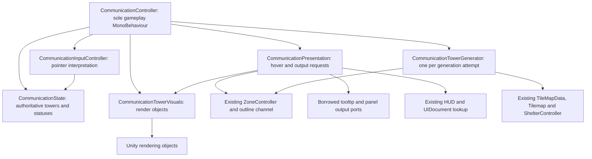

# CommunicationSystem — Stage C5: Final Architecture and Retirement

Date: 2026-10-23. C5 verification passes. CommunicationController remains the sole public gameplay authority, coordinating five internal helpers and all six migrated consumers. No obsolete functional dependency requires cleanup. The original GUID, scene component, 24 Inspector assignments, four inbound references and 17 public signatures are preserved. Both fresh managed runs pass 348 assertions with 108 identical traces; 207 runtime sources compile with zero errors and the same 11 warnings. The generated IDE project is refreshed. Successful Play Mode verification after C4 is user-performed. C5 adds only this report and metadata.

## 1. Final completion status

**COMPLETED.** The architecture, dependency, consumer, serialization, compilation and managed regression checks all pass against the completed C4 implementation. No production edit or additional retirement is necessary. The remaining old wording is covered by the request's explicit compatibility/diagnostic exceptions.

Read the C1, C2, C3 and C4 reports and inspected the current source implementations and saved scene. Earlier reports retain their historical terminology and verification status. Current source/YAML checks and fresh executions below establish C5's results; earlier test counts were not assumed to be fresh results.

## 2. Files and components verified

| Role | Current repository path |
| --- | --- |
| Authoritative MonoBehaviour and shared global types | `Assets/Game/Features/MitigationFeatures/Communication/CommunicationController.cs` |
| Generator | `Assets/Dev/Dev_CommunicationSystem/Dev_CommunicationTowerGenerator.cs` |
| State | `Assets/Dev/Dev_CommunicationSystem/Dev_CommunicationState.cs` |
| Visuals | `Assets/Dev/Dev_CommunicationSystem/Dev_CommunicationTowerVisuals.cs` |
| Input | `Assets/Dev/Dev_CommunicationSystem/Dev_CommunicationInputController.cs` |
| Presentation | `Assets/Dev/Dev_CommunicationSystem/Dev_CommunicationPresentation.cs` |
| Panel consumer | `Assets/Game/Features/MitigationFeatures/Communication/CommunicationPanelController.cs` |
| Tooltip consumer | `Assets/Dev/Scripts/Zones/MapHoverTooltipController.cs` |
| Actions consumer | `Assets/Dev/Scripts/PanelController/ActionsPanelController.cs` |
| Summary consumer | `Assets/Dev/Scripts/GameStateSummary/GameStateSummaryBuilder.cs` |
| Resource-bar consumer | `Assets/Dev/Scripts/Main_UI/UI_Overlay/Dev_ResourceBarRuntime/Scripts/ResourceBarRuntimeController.cs` |
| Advisor consumer | `Assets/Game/Features/UI/Scripts/UI_Advisor_Scripts/AdvisorPanelController.cs` |
| Retained gameplay scene | `Assets/Game/Content/Scenes/PlayableTilemap.unity` |

The original controller metadata, five helper metadata files and folder metadata were also checked. All **207 current runtime sources are byte-identical to the completed C4 source snapshots**, including the six full consumer files.

Captured entry Git status and hashes of **6,298 files** under Assets, Packages, ProjectSettings and UserSettings. C5 creates only:

- `Assets/Dev/AgentRef/Records/CommunicationSystem_StageC5_FinalArchitectureAndRetirement.md`
- Its new `.md.meta`, following the existing report metadata format with a fresh GUID.

Final scope verification preserves every entry file byte-for-byte, including all C1–C4 reports, existing code changes, font/scene/layout edits and metadata. The intentionally deleted former development scene and its metadata remain absent. No scene was restored, replaced, edited or run by Codex in C5.

## 3. Final architecture



The helper dependency graph is acyclic: only Input → State and Presentation → Visuals are helper-to-helper edges. No helper retains, discovers or invokes a CommunicationController gameplay API; none owns a lifecycle callback or publishes gameplay events. Presentation's diagnostic context is a borrowed Unity Object used for logging, not an owner API. UI status reads continue through the public facade, while the composition root supplies presentation output methods.

The controller owns one state, visuals, input and presentation instance. `CommunicationTowerGenerator generator = new(...)` remains a local inside the validated generation attempt, after status initialization; it is not a persistent field. Each yielded tower is stored and spawned before the next group is evaluated. The controller retains Awake, Start, Update, OnDisable, OnValidate, bounded startup retry, public queries/events, reference resolution and gameplay ordering. No singleton, wrapper, alias or second gameplay controller was introduced.

There is one authoritative tower list plus its cell lookup and one zone-status dictionary, all in State. Visual dictionaries hold rendering objects; summary DTOs and query snapshots remain downstream outputs. The generator's temporary groups, candidates and occupied-cell set exist only for an attempt/enumeration. Communication creates no ZoneIndex, outline renderer, extra map/zone cache or independent hover cache. The pre-existing panel/tooltip/resource UI components are consumers, not additional gameplay authorities.

## 4. Public CommunicationController API

All **17** C4 signatures remain: two properties, three instance C# events and 12 methods.

```csharp
bool IsCommunicationModeActive { get; }
IReadOnlyList<CommunicationTowerData> CommunicationTowers { get; }
event Action<bool> CommunicationModeChanged;
event Action<CommunicationTowerData> OnTowerActivated;
event Action<string> OnZoneWarned;
void ToggleCommunicationMode();
void SetCommunicationMode(bool active);
void ShowCommunicationTowers();
void HideCommunicationTowers();
bool TryGetCommunicationStatus(string geoid, out ZoneCommunicationStatus status);
IReadOnlyList<CommunicationTowerData> GetAllTowers();
IReadOnlyList<CommunicationTowerData> GetActiveTowers();
ZoneCommunicationStatus GetZoneCommunicationStatus(string geoid);
Dictionary<string, ZoneCommunicationStatus> GetAllZoneCommunicationStatuses();
void MarkZoneWarned(string geoid);
void NotifyActionButtonConnected();
void RegenerateCommunicationTowers();
```

The existing Regenerate context-menu attribute remains. No additional public gameplay entry point exists. `CommunicationTowerData` remains a global serializable reference class with `string towerId`, `Vector3Int tileCell`, `Vector3 worldPosition`, initialized `List<string> associatedZoneGeoids` and `bool isActive`. The global enum remains `Unreached = 0`, `Pending = 1`, `Warned = 2`. Their source definitions, field/reference semantics and serialization are unchanged.

The public tower list/property still expose the same live list; active-tower queries return a filtered list of the same tower objects; status snapshots are independent dictionary copies. There is no new lazy generation or mutation in the query methods.

## 5. Responsibilities of the five internal helpers

| Internal sealed plain class | Responsibility and ownership |
| --- | --- |
| CommunicationTowerGenerator | Ordinal ordering, nearest-zone grouping, tile-weighted placement center, perimeter scoring, terrain/water/shelter avoidance, occupancy, IDs and cell/world records. Borrows existing providers and zone membership; keeps only provider/settings fields, with temporary generation collections. |
| CommunicationState | Sole owner of `_communicationTowers`, `_towerByCell`, `_zoneStatusByGeoid`, generated/mode flags, queries and activation/Pending/Warned mutations. Returns outcomes to the facade; does not publish events or reference UI/scene providers. |
| CommunicationTowerVisuals | `_towerVisualById`, `_towerRendererById`, missing-sprite diagnostic flag, spawning/updating/clearing/visibility, colors/sprites/scale/height/sorting. Owns no communication statuses or activation authority. |
| CommunicationInputController | Stateless screen/camera/world/cell lookup and left-button intent. Borrows State's lookup. Button polling remains after hover presentation and short-circuits without a hovered tower. |
| CommunicationPresentation | Sole current hovered-tower reference and outline-failure diagnostic flag, CommunicationZones requests/cleanup, shared tooltip configuration/show/hide, host lookup and panel output requests. Receives the same visuals instance and narrow callback ports. |

Settings, PointerSample, Context and TooltipBindings remain transient argument/value bundles. The controller's tooltip binding cache stores method bindings by UI target identity, not gameplay or map data. No helper implementation or responsibility changed during C5.

## 6. Six-consumer integration inventory

Every listed consumer retains `[SerializeField] private CommunicationController communicationTowerController;`. No field, public method, subscription flag or callback was renamed in C5.

| Consumer | Calls, discovery and lifecycle verified |
| --- | --- |
| CommunicationPanelController | Existing discovery in ResolveReferences; ShowForTower receives the original tower object; TryGetCommunicationStatus drives display/selection; selected warnings call MarkZoneWarned synchronously. No communication event subscription. UI bind retries, stored callbacks, warning sprites, populations/tabs and disable cleanup remain intact. |
| MapHoverTooltipController | Existing discovery during resolution and active-tower status lookup; `SetCommunicationTowerController(CommunicationController controller)` is unchanged. Inactive/active/null/missing/all-warned summaries and shared evacuation tooltip behavior remain intact. No communication event subscription; enable/disable retain shared-tooltip cleanup. |
| ActionsPanelController | Existing discovery and late Toggle resolution; ToggleCommunicationMode, NotifyActionButtonConnected and mode reads unchanged. CommunicationModeChanged subscription/unsubscription retains guards and OnEnable/OnDisable scheduling; handler updates the existing button state. |
| GameStateSummaryBuilder | Existing discovery, mode/activation/warning subscriptions and matching unsubscriptions through enabled lifetime. Actual tower/status queries, display-ID conversion, sorted zone summary and event-triggered refresh reasons remain intact. |
| ResourceBarRuntimeController | Existing discovery and activation/warning subscription guards/unsubscriptions through enabled lifetime. Original mitigation-action/turn update flags and unscaled-time cooldown remain. Its existing UI bootstrap does not create a communication authority. |
| AdvisorPanelController | Existing discovery, subscription opt-out/guards and enabled-lifetime activation/warning subscription cleanup. Same event payloads, display IDs and message construction remain. |

Actions has one existing factory reached from two existing paths: ResolveReferences and late Toggle resolution. Both first discover `CommunicationController` and create only after discovery fails. The factory uses `AddComponent<CommunicationController>()`. Managed cases verify reuse of the scene component, cached references, fallback reuse by another Actions consumer, repeated resolution/toggle and one controller instance. No new creation path was added.

The established activation order remains **mark active → update visuals → apply Pending transitions → synchronously publish OnTowerActivated → open the panel**. Repeated active-tower selection only reopens the panel. Warning writes precede synchronous OnZoneWarned; subscriber counts and the resource cooldown retain their original behavior.

## 7. Legacy dependency search and retirement results

Fresh read-only searches covered **240 C# files**, including runtime/editor/test locations, **950 text serialized/UI assets** (55 scenes, 159 prefabs and other asset/UI formats), assembly definitions/references, package/project/tooling configuration, hidden maintained files and generated IDE projects. Generated Library/Temp/Logs/obj/Build and Git history were excluded. Persistent-call inspection covered **236 scene blocks, 665 prefab blocks and one asset block** containing m_PersistentCalls; these are containing-block counts, not listener counts.

| Search | Result |
| --- | --- |
| Old class declaration, alias, source and metadata path | Absent. |
| Old compile-time/typeof/AddComponent/GetComponent/discovery references | None. |
| Old reflection/type-resolution strings | None; retained literals are diagnostics or the existing GameObject label. |
| Old serialized type/assembly-qualified references and UnityEvent bindings | None in inspected assets. No communication persistent-call dependency found. |
| Old source filename in maintained or generated configuration | None. |
| Current controller type usage | Exactly its declaration and the six audited consumer files. |
| Helper usage | Confined to the facade/helper implementation graph; no consumer bypasses the public facade. |
| Script GUID ownership and bindings | One metadata owner and one scene component, both intentional/current. |
| Duplicate authoritative state/controller/component | None found in source or serialized assets; managed discovery/fallback checks pass. |

There are **40 lines across nine source files** containing the capitalized legacy spelling. All are permitted non-functional wording/member names: 24 diagnostic lines, one runtime GameObject label, three private factory declaration/call lines, two public tooltip-setter declaration/call lines and ten private subscription-flag lines. The lower-case serialized `communicationTowerController` names and all their usages are also intentionally preserved.

C1–C4 and older historical documents retain their original terminology. Existing informational header comments mention retired setup names but create no type/asset dependency. No misleading label requires a functional correction. Consistent with C5's preference, these labels/comments were left intact; no cosmetic source edits, deletions or compatibility layer were introduced.

The ignored `Assembly-CSharp.csproj` now lists `Assets/Game/Features/MitigationFeatures/Communication/CommunicationController.cs` at line 53 and contains no obsolete filename. C4's stale generated-project entry has been resolved externally. Codex did not manually edit generated projects, ProjectSettings, packages or Editor preferences.

## 8. GUID and serialization verification

| Identity | Verified value |
| --- | --- |
| Current/original script GUID | `98e604977a2f4ef5ac4190852d01e7fa` |
| Metadata owner | `CommunicationController.cs.meta`, exactly one owner; original bytes preserved |
| Metadata SHA-256 | `1fd03dd987ebf5b944b9f54fc761d9c382c60919307878bc1ca1bfc44f88ebe0` |
| Scene component fileID | `810699005` |
| Owning GameObject fileID | `810699003` |
| Script binding | `{fileID: 11500000, guid: 98e604977a2f4ef5ac4190852d01e7fa, type: 3}` |
| Scene component count | One script binding and one original GameObject component-list entry |
| Scene SHA-256, matching C4 | `482a2ccedd674f2b1af5cd095982d0b0a7de1bfb2b4faa7031bc5ee426dc0796` |

The component's EditorClassIdentifier is empty, so no obsolete explicit class string remains in that binding. No replacement/duplicate component or metadata was added. All **24** field names/types/defaults and saved assignments match C4:

| Inspector field | Saved assignment |
| --- | --- |
| `tileMapData` | `{fileID: 11400000, guid: 7e81a30567a6c1b44ae537c0db92678b, type: 2}` |
| `communicationTilemap` | `{fileID: 36957482}` |
| `zoneController` | `{fileID: 2070746514}` |
| `shelterController` | `{fileID: 1420635165}` |
| `mainCamera` | `{fileID: 917516086}` |
| `mapHoverTooltip` | `{fileID: 0}` |
| `tooltipUIDocument` | `{fileID: 2082171433}` |
| `communicationPanelController` | `{fileID: 2100000004}` |
| `mainTowerSprite` | `{fileID: 21300000, guid: 7e25c158da0c7974cbf783bc599cbba3, type: 3}` |
| `zoneTowerSprite` | `{fileID: 21300000, guid: 984ce4b18bfef434881def49d974e4c6, type: 3}` |
| `towerVisualRoot` | `{fileID: 1688803249}` |
| `inactiveTowerColor` | `{r: 0.62, g: 0.86, b: 1, a: 0.85}` |
| `activeTowerColor` | `{r: 0.25, g: 1, b: 0.55, a: 1}` |
| `hoveredTowerColor` | `{r: 1, g: 0.95, b: 0.35, a: 1}` |
| `associatedZoneHoverColor` | `{r: 0.2, g: 0.85, b: 1, a: 1}` |
| `towerVisualScale` | `0.45` |
| `towerHeightOffset` | `0.35` |
| `towerSortingLayerName` | `Default` |
| `towerSortingOrder` | `2300` |
| `zonesPerTower` | `3` |
| `towerSearchRadius` | `4` |
| `showInactiveTowersAtStart` | `1` |
| `avoidShelterTiles` | `1` |
| `debugLogs` | `1` |

All four incoming fields remain `communicationTowerController: {fileID: 810699005}`:

| Inbound component | Consumer |
| --- | --- |
| `515287497` | AdvisorPanelController |
| `1389987227` | ActionsPanelController |
| `2019949261` | GameStateSummaryBuilder |
| `2100000004` | CommunicationPanelController |

Whole-scene bytes match the C4 baseline. No scene YAML modification or serialization migration was required. The original GUID remains valid and must not be retired along with the obsolete filename.

## 9. Runtime compilation results

Fresh managed compilation used the installed Unity 6000.0.63f1 Roslyn compiler and existing Unity/package/assembly references, with freshly enumerated sources under the same default-runtime-assembly boundary as C4. Editor folders and sources owned by separate assembly definitions/references remain outside that source set; their existing assembly outputs supply references.

| Build | Sources | Errors | Warnings |
| --- | --- | --- | --- |
| Captured completed C4 runtime | 207 | 0 | 11 |
| Current repository runtime | 207 | 0 | 11 |
| C4 managed harness | Existing C2/C3/C4 coverage | 0 | 0 |
| Current-source managed harness | Same coverage | 0 | 0 |

The runtime warning message multiset matches the recorded C4 result: one CS0105 duplicate using, eight CS0618 obsolete API uses and two CS0414 assigned-unused fields (`CardLoader.disabledAlpha`, `GameStateSummaryBuilder.logDisplayIdMappings`). No new diagnostic was introduced. All six complete consumer files compile in the 207-source runtime build.

## 10. Regression test results

Both fresh runs use the **completed C4 implementation** as the baseline, rather than the pre-rename controller. Current runtime inputs use repository files; baseline inputs use captured C4 source files. Consumer probe source remains an exact excerpt of the unchanged C4/current consumers.

| Existing coverage | Assertions per run | Matching states/traces |
| --- | --- | --- |
| C2 generation/state and retained cases | 215 | 73 |
| C3 rendering/input/presentation | 88 | 26 |
| C4 API/consumer integration | 45 | 9 |
| Total | **348 passed** | **108 matched** |

**Additional C5 managed assertions: 0.** Static architecture/dependency/asset checks are recorded separately in audit.json and are not added to that harness count. Both entire outputs are byte-identical to each other **and to the recorded completed C4 output**. No identity, source-path, message or gameplay normalization was applied.

Verified cases retain deterministic grouping, scoring/ties, category/water/shelter rejection, tower IDs/cells/world positions/GEOIDs, nonzero and negative origins, readiness/retry bounds, generation interleaving, initial/mode visibility, active-tower queries/status copies, sprites/colors/sorting, hover/click ordering, CommunicationZones isolation, shared-tooltip configuration/cleanup and panel requests. State checks cover Unreached/Pending/Warned, committed synchronous event state/order, repeat warning/activation suppression, repeat selection, successful/failed regeneration and disable/re-enable behavior.

C4 coverage also retains scene-versus-fallback Actions discovery/reuse, duplicate-subscription guards, unsubscribe/resubscribe/opt-out, panel warning submission, tooltip status queries, advisor wording, resource turn/cooldown behavior and synchronous summary calculations. Existing reset, failure, fallback and stale-reference semantics remain unchanged.

The harness executes real controller/helpers and zone/index/geometry/outline sources with controlled Unity/map/shelter/UI stand-ins. Consumer coverage includes **35 extracted methods or communication subscription branches**, with unrelated output endpoints instrumented; it does not instantiate the six complete UI components in native Unity. Full source compilation and byte equality complement those probes.

Fresh evidence directory:

`/var/folders/k0/k_vxwym14hs2n16m3n8bt2t40000gn/T/communication-stage-c5-umtwr0qc`

It contains baseline status/hashes, frozen C4 runtime sources, audit.json, results.json, compiler response files/logs, harness inputs and full trace logs. replay.py recompiles/runs the frozen-C4/current comparison and verifies the same counts/output without normalization. These temporary artifacts are outside Assets and are not a permanent CI test suite.

## 11. Native Unity verification status

| Verification | Status and attribution |
| --- | --- |
| Unity Play Mode after C4 | **Successful, user-performed**, as explicitly reported in the C5 request. Recorded as the user's verification, not Codex execution. |
| Generated IDE project | Read-only inspection confirms the new source path is present and the obsolete path absent. This resolves the C4 IDE-cache follow-up. |
| C5 Codex managed checks | Runtime/harness compilation and regression execution performed as described above. |
| C5 Codex source/YAML inspection | Original GUID/component/fields/references and absence of obsolete functional bindings verified. |
| C5 Codex native import/Play Mode/player build | Not performed. No clean Unity Editor import or native build is claimed. |

Only PlayableTilemap is authorized for gameplay testing. Codex did not open/run a different scene, restore the deleted development scene, or change Editor settings. The user report supplies successful Play Mode verification but does not provide an itemized native test log; this report does not invent additional native scenario results.

## 12. Remaining known limitations

- Managed stand-ins establish logic, object identity, sequencing and requested UI/rendering calls. They do not establish actual JSON loader timing, native camera/input scheduling, coroutine frame scheduling, deferred destruction, UI Toolkit layout/callback dispatch or a clean platform build. The user's successful Play Mode report is separately attributed above.
- Existing external assembly outputs were reused for managed compilation; separate package/Editor assemblies were not rebuilt from scratch. Generated Library contents were not treated as maintained source or manually rewritten.
- Existing behavior remains deliberate compatibility scope: bounded startup polling without a new re-enable restart, destructive failed regeneration with retained statuses, mutable tower references, stale hover/panel targets after regeneration, legacy Input and shared-tooltip host competition. C5 does not change those contracts.
- Temporary harness artifacts can be removed by the OS and are not installed as lasting project tests. C1–C4 historical reports retain their original evidence and limitations rather than being retroactively rewritten.

## 13. Recommended future improvements outside this refactor

These are separate possible work items, not required refactor follow-ups and not implemented by C5:

- Move the useful managed fixtures into an explicitly approved, durable test/CI location with maintained engine adapters.
- Make separate product decisions about regeneration reset/stale presentation handling and retry-on-re-enable behavior before changing either contract.
- Review shared-tooltip host coordination or an input-system migration as independent changes with their own behavior baselines.
- Refresh stale setup comments/diagnostic labels only when useful, preserving serialized/public names and explicit test expectations.

## 14. Final assessment

**COMPLETED.** All required source, architecture, API, dependency, serialization, runtime compilation and managed regression checks pass. Successful post-C4 Play Mode verification is recorded as user-performed. No obsolete functional dependency, unexpected behavior difference, missing reference, duplicate authority or out-of-scope cleanup was found.

CommunicationSystem C1–C5 refactor complete. CommunicationController is the sole authoritative public communication gameplay controller. No active CommunicationTowerController dependency remains.

C5 changed only this report and metadata. Review and commit the completed refactor checkpoint while preserving the unrelated changes already present in the working tree.
