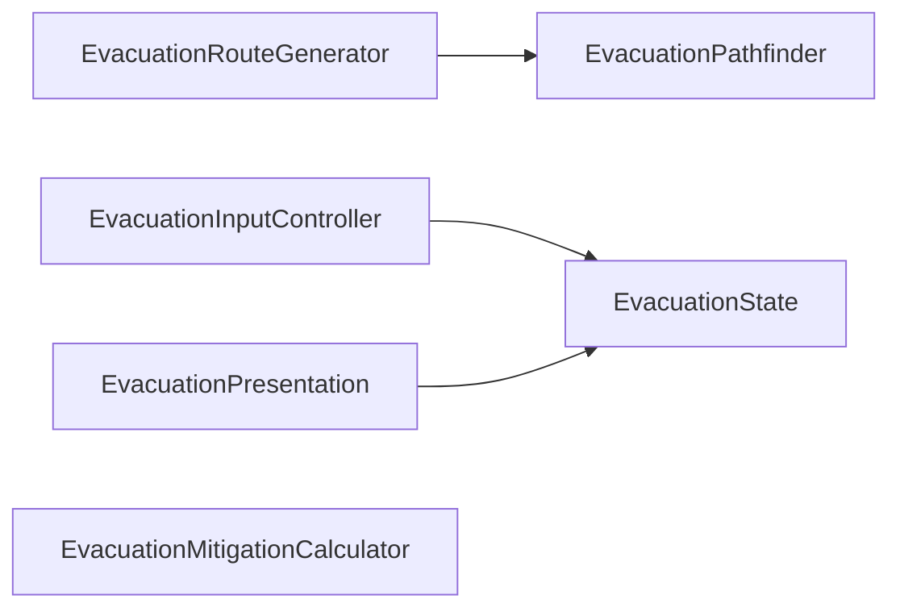

# EvacuationSystem — Stage E5: Final Architecture Verification and Legacy Review

Date: 2026-10-26 (America/New_York). Scope: report and normal report metadata only. No further extraction, retirement or refactor is performed.

## 1. Executive summary and completion verdict

**Architecture and managed compatibility verification pass; E5 sign-off is conditional, with the serialized-asset gate blocked.** The facade, six internal helpers, public contract, authoritative state and existing rendering/UI ownership are preserved. Fresh compilation passes with 213 sources, zero errors and 11 unchanged warnings; the unchanged E4 replay passes 240 assertions per implementation and 80 matching traces. Seven pre-existing unresolved script bindings remain detectable in PlayableTilemap. Their runtime status needs assessment before asserting a scene-wide clean serialization audit. The user reports all E4 Play Mode tests passed. Only this report and its metadata are created.

The blocker is a pre-existing serialized-asset finding, not an observed evacuation regression or an active dependency on the legacy evacuation tooltip. The requested blanket confirmation of no detectable missing-script references cannot be made. Section 6 identifies the exact bindings, section 17 distinguishes native verification, and section 20 gives the closure condition. No speculative GUID repair is authorized or attempted.

## 2. E1–E5 stage summary

| Stage | Completed work / verification |
| --- | --- |
| [E1](EvacuationSystem_StageE1_DependencyAudit.md) | Dependency and behavior baseline; public API, serialization, consumers, event order, route data and quirks recorded. Original source/scene captures remain available. |
| [E2](EvacuationSystem_StageE2_RouteGenerationPathfindingExtraction.md) | RouteGenerator and Pathfinder extracted; original ordering, A*, traversal and coordinate behavior preserved. |
| [E3](EvacuationSystem_StageE3_StateMitigationExtraction.md) | State and MitigationCalculator extracted; sole collection/cache ownership established with live references and synchronous policy timing preserved. |
| [E4](EvacuationSystem_StageE4_InputPresentationExtraction.md) | Fieldless InputController and Presentation extracted; 213-source compilation, 240 assertions and 80 matching traces. User independently reports all native Play Mode tests passed. |
| E5 | Current-source, dependency, API, GUID, serialized-reference, visualizer and legacy/UI audit; unchanged replay and fresh compilation rerun. Report delivered; unconditional final sign-off withheld for the pre-existing serialized bindings below. |

All four prior reports were read. Conclusions below also use current source and serialized assets, rather than treating historical report statements as proof of the present state.

## 3. Final controller/helper architecture

The sole global `public class EvacuationController : MonoBehaviour` remains at `Assets/Game/Features/MitigationFeatures/Evacuation/EvacuationController.cs`. The six helpers remain under `Assets/Dev/Dev_EvacuationSystem/`, each declared `internal sealed class` with no Unity component base class.

| Owner | Responsibility and persistent ownership |
| --- | --- |
| EvacuationController | Unity lifecycle; serialized dependencies/settings; discovery; original public contract; generation coordination; selection/confirmation policy; mitigation recalculation timing; all public gameplay event publication; input/presentation orchestration. Owns readonly instances of State, Calculator, Input and Presentation. Constructs generation/pathfinding helpers locally for rebuilding after the original clear/validation steps. |
| EvacuationRouteGenerator | Shelter-major/zone encounter enumeration; anchor selection; route metadata/construction; ordered incremental appends into the borrowed available list. Holds dependency/settings references, not a second route collection. |
| EvacuationPathfinder | Existing four-neighbor A*, live tile/flood reads, costs, bounds, reconstruction and conversions. Search lists/dictionaries are local to a search. Static readonly neighbor offsets are configuration, not traversal state. |
| EvacuationState | Exactly seven persistent fields: available list, visible list, cell-to-route-ID dictionary, ordinal selected-ID set, hovered ID, confirmation flag and confirmed ID. Sole authoritative route/selection/hover/confirmation/lookup owner. |
| EvacuationMitigationCalculator | Exactly three persistent fields: ordinal evacuated-population and mitigation dictionaries, plus total evacuated population. Sole authoritative mitigation cache. |
| EvacuationInputController | Legacy mouse/world/cell sampling, State hit testing, hover-change interpretation and synchronous private facade click dispatch. **Zero persistent fields**, including no retained callback. |
| EvacuationPresentation | Original temporary render-list preparation, State visibility/lookup coordination, existing visualizer calls and shared-tooltip dispatch/clear/follow. **Zero persistent fields**, including no render cache or retained component. |

No helper becomes a public gameplay facade, singleton, service locator, MonoBehaviour, serialized component, independent event publisher, renderer or tooltip system. There is one generation implementation and one A* implementation. Facade collection/cache duplicates were not reintroduced. Visualizer caches remain presentation caches, separate from authoritative State. The unchanged global route DTO remains public data, not a second controller.

## 4. Helper dependency graph

This is the complete typed helper-to-helper dependency graph; isolated helpers are shown explicitly:



The graph is acyclic. Input and Presentation have no dependency on each other. Calculator borrows primitive/data collections, without a typed State/Generator/Pathfinder dependency. The facade coordinates all six.

| Helper | Borrowed controller/component/data dependencies | Lifetime |
| --- | --- | --- |
| Generator | ShelterController, ZoneController, ZoneBaselineRiskController, route Tilemap and Pathfinder; supplied available-route List | Constructor-held providers/settings for the local rebuild helper; destination list supplied per operation. No facade field. |
| Pathfinder | TileMapData, route Tilemap, ZoneController, scalar costs/limits | Constructor-held providers/settings for the local rebuild helper; per-search data stays local. No facade field. |
| State | SimpleEvacuationRoute references and value IDs/cells | Owns collections; no Unity component/controller/discovery dependency. |
| Calculator | Available route list, selected-ID set; per-call `Func<string,int>` source-population fallback | Borrows call inputs without retaining them. The function is bound to the facade's private population forwarder and can synchronously re-enter existing providers. |
| Input | State, route Tilemap, Camera; `Action<string,Vector2>`, `Action<Vector2>`, `Func<string,bool>` private facade actions | Call-scoped; no stored facade/component/callback. Input reads legacy static Unity Input directly, as before. |
| Presentation | State, EvacuationRouteVisualizer, MapHoverTooltipController, route Tilemap, route objects and settings | Call-scoped; visualizer/shared-tooltip `ref` parameters retain the original component retarget behavior across callbacks without storing a reference. |

The transient facade callbacks are intentional synchronous control flow, not additional stored helper graph edges. This distinction matters: including a caller's callback return path in a runtime call graph would draw a cycle, but there is no circular typed helper dependency or permanent helper-to-facade reference. Re-entry behavior is preserved rather than redesigned. Existing MapHoverTooltipController discovery/runtime creation remains in the facade, outside helpers. No assembly definition/reference boundary changed.

## 5. Public API and consumer verification

Comparison with the captured E1 source verifies the same global class/base class, exact ordered five property declarations, 22 method signatures, six event declarations and ordered 15 Invoke expressions. GUID remains `ef31d31705ac48f898e5746ce90d32fa`.

Properties: `bool IsPreviewModeActive`, `SimpleEvacuationRoute CurrentRoute`, `IReadOnlyList<SimpleEvacuationRoute> CurrentRoutes`, `bool HasConfirmedEvacuationRoute`, `string ConfirmedRouteId`. Their original read behavior and data references remain intact.

The full preserved method inventory, including aliases and overloads:

```csharp
public bool IsPreviewActive()
public IReadOnlyList<SimpleEvacuationRoute> GetAvailableRoutes()
public IReadOnlyList<SimpleEvacuationRoute> GetSelectedRoutes()
public bool IsRouteSelected(string routeId)
public void ShowOnlySelectedRoute(string routeId)
public void ShowOnlySelectedRoute(int routeIndex)
public void ClearRouteSelectionAndShowAll()
public void ToggleEvacuationPreview()
public void ToggleEvacuationPreviewMode()
public void ShowEvacuationRoutes()
public void HideEvacuationRoutes()
public void RefreshEvacuationRoutes()
public void ShowSingleEvacuationRoute()
public void HideEvacuationRoute()
public void RefreshSingleRoute()
public bool HasEvacuationRouteForZone(string geoid)
public bool HasSelectedEvacuationRouteForZone(string geoid)
public bool TrySelectRoute(string routeId)
public float GetEvacuationMitigationForZone(string geoid)
public int GetEvacuatedPopulationForZone(string geoid)
public int GetRemainingPopulationAfterEvacuation(string geoid)
public int GetTotalEvacuatedPopulation()
```

The six preserved event declarations:

```csharp
public event Action OnEvacuationRoutesChanged;
public event Action OnEvacuationRoutesBuilt;
public event Action OnEvacuationRoutesHidden;
public event Action<SimpleEvacuationRoute> OnEvacuationRouteSelected;
public event Action<SimpleEvacuationRoute> OnEvacuationRouteDeselected;
public event Action<SimpleEvacuationRoute> OnEvacuationRouteConfirmed;
```

All seven external consumers still hold the original typed EvacuationController contract and compile in the full runtime assembly:

| Consumer source | Actual contract usage / subscriptions |
| --- | --- |
| `Assets/Dev/Scripts/PanelController/ActionsPanelController.cs` | Preview toggle/property; Built and Hidden listeners. |
| `Assets/Dev/Scripts/GameStateSummary/GameStateSummaryBuilder.cs` | Available/selected lists, selection/preview status, total/zone population and mitigation/remaining getters; Built, Hidden, Selected and Deselected listeners. |
| `Assets/Game/Features/UI/Scripts/UI_Advisor_Scripts/AdvisorPanelController.cs` | Confirmation property; Selected and Confirmed listeners. |
| `Assets/Dev/Scripts/Main_UI/UI_Overlay/Dev_ResourceBarRuntime/Scripts/ResourceBarRuntimeController.cs` | Selected listener for turn advancement/cooldown; existing AfterSceneLoad runtime bootstrap remains unchanged. |
| `Assets/Dev/Scripts/Zones/ZoneBaselineRiskController.cs` | Pulls zone population/mitigation; no evacuation event subscription. Its population-provider relationship with the facade is preserved. |
| `Assets/Dev/Scripts/Flood/FloodImpactController.cs` | Pulls population/mitigation through facade; no evacuation event subscription. |
| `Assets/Dev/Dev_CommunicationSystem/CommunicationPanelController.cs` | Pulls available/selected zone-route status; no evacuation event subscription. |

All seven retain existing FindFirstObjectByType fallback discovery. The six scene-assigned facade references remain on components `35733723`, `515287497`, `1389987227`, `1590100951`, `2019949261` and `2100000004`, pointing at `315251714`. The ResourceBar consumer retains runtime discovery. There is no external RoutesChanged subscriber in current source.

Current declarations and actual receiver/member calls were inspected, beyond name matching. Searches found one EvacuationController declaration, the six intended internal helpers, and no alternate/replacement evacuation gameplay controller or obsolete consumer migration. No external source uses the legacy tooltip type, including typed AddComponent/GetComponent or discovery. No evacuation-targeted reflection/assembly-qualified type string or serialized UnityEvent dependency was found. ResourceBar's UnityEvent search hits are unrelated turn/storm events, not hidden evacuation method calls. No persistent `m_Target` call targets the three evacuation component IDs. No helper GUID is attached in the serialized scene/prefab/other asset scan.

## 6. Serialized scene/component/GUID verification

Only `Assets/Game/Content/Scenes/PlayableTilemap.unity` is considered an authorized gameplay scene. Other existing assets were read for reference inventory only, never opened/run or modified. Its 342 serialized records include the original enabled evacuation components:

| Component | Script GUID | Component fileID | GameObject fileID |
| --- | --- | --- | --- |
| EvacuationController | `ef31d31705ac48f898e5746ce90d32fa` | `315251714` | `315251712` |
| EvacuationRouteVisualizer | `37785d2c97374ef3abdc0d8dc1ba82b6` | `1117061671` | `1117061669` |
| EvacuationRouteTooltipController | `908e8eaeef6084fcf840ee5b5e6f5cad` | `817002036` | `817002034` |

Each full component record is byte-identical to the captured E1 record, with the same script/owner references and `m_Enabled: 1`. All 23 serialized facade declarations retain names, types, attributes and initializers; current Inspector assignments are:

| Field | Serialized value |
| --- | --- |
| `baselineRiskController` | `{fileID: 1590100951}` |
| `shelterController` | `{fileID: 1420635165}` |
| `zoneController` | `{fileID: 2070746514}` |
| `tileMapData` | `{fileID: 11400000, guid: 7e81a30567a6c1b44ae537c0db92678b, type: 2}` |
| `routeTilemap` | `{fileID: 36957482}` |
| `routeVisualizer` | `{fileID: 1117061671}` |
| `mapHoverTooltip` | `{fileID: 0}` |
| `routeTooltipUIDocument` | `{fileID: 2044171025}` |
| `mainCamera` | `{fileID: 917516086}` |
| `routeColor` | `{r: 1, g: 0, b: 0.3026948, a: 1}` |
| `debugLogs` | `1` |
| `previewModeActive` | `1` |
| `maxPathSearchIterations` | `6000` |
| `minimumVisibleRouteLengthTiles` | `8` |
| `skipShortRoutes` | `1` |
| `roadTileCost` | `1` |
| `landTileCost` | `3` |
| `waterTileCost` | `5` |
| `deepFloodWaterThreshold` | `0.5` |
| `allowRouteSelection` | `1` |
| `limitSelectedRoutes` | `0` |
| `maxSelectedRoutes` | `3` |
| `lockRouteAfterSelection` | `1` |

The saved preview flag remains 1 while Awake still forces preview off. Scene values intentionally override several source defaults, including land cost, selection limits and locking. The null shared-tooltip field retains the existing runtime discovery/creation path; it is not a missing script binding. Visualizer and legacy-tooltip Inspector records remain wholly identical to E1. No helper is attached to a scene or prefab. All ten inspected scripts have exactly one project metadata owner for their GUID, and no duplicate GUID ownership was detected across Assets.

**Serialization exception / conditional sign-off:** scanning 55 existing scenes and 159 prefabs against project metadata, Packages and installed Library/PackageCache metadata detects 295 unresolved MonoBehaviour script records in 80 files, representing 34 distinct GUIDs. Explicit null `m_Script` records were not found. These are static unresolved-GUID findings; they do not establish the exact native imported Inspector state. Every affected asset is byte-identical to the pre-E4 snapshot, so none was introduced by E4 or E5. Most are third-party examples, with additional retained Dev assets. Seven are in the authorized scene:

| Component fileID | Owning GameObject name (not inferred script type) | Unresolved m_Script GUID |
| --- | --- | --- |
| `35733722` | FloodImpactController | `6c1278d19cccb4a3da4563a6458f29fa` |
| `434996196` | ShelterPresentation | `c32d7337dc7a94591bd7e955b4968ba4` |
| `555384876` | UIDocument | `5145aba9c2a8f4b2ea7c85a977475f1e` |
| `748270052` | ShelterPlacementInput | `94259d23cf9f043cd96b10d0e72dbb21` |
| `1420635163` | ShelterController | `b516d3fb7dd444b769132f5e17485a7e` |
| `1434780123` | UIDocument | `3a49d09d23d6483fb909c984ac5131dd` |
| `1678446138` | JsonMapLoaderObject | `9dacb7ec027494fa3a48748735e186e5` |

All seven records have `m_Enabled: 1`. These exact fileID/GUID pairs were already documented in [ZoneSystem Stage 5FG, existing scene issue](ZoneSystem_Stage5FG_LegacyOutlineRetirement.md). That historical audit lists an additional component subsequently retired; the seven above are the current remaining entries. The current whole scene is unchanged from the pre-E4 snapshot. The valid current FloodImpactController reference `35733723` and ShelterController reference `1420635165` are separate records from the unresolved `35733722` and `1420635163` entries; matching GameObject names must not be mistaken for valid script identity.

The three requested evacuation GUID bindings are valid, but a blanket claim that the entire scene has no detectable missing scripts would contradict this scan. Native resolution/assessment of these records is the outstanding sign-off condition. No GUID, component list or YAML correction is attempted. No existing scene/prefab bytes changed during E5. Intentionally deleted `Dev_UINavigation.unity` and its metadata remain absent; neither was restored, recreated or run.

## 7. SimpleEvacuationRoute compatibility

The complete global `[Serializable] public class SimpleEvacuationRoute` definition is byte-identical to E1, including all eleven public serialized fields:

```csharp
public string routeId;
public string sourceZoneGeoid;
public int sourceZonePopulation;
public string destinationShelterId;
public string destinationShelterType;
public int destinationShelterCapacity;
public Vector3Int startCell;
public Vector3Int shelterCell;
public List<Vector3Int> pathCells = new();
public float distanceTiles;
public bool isValid;
```

It remains mutable reference data; no record/struct, namespace change, defensive route clone or path copy was introduced. CurrentRoutes and GetAvailableRoutes return the same live State available-list object, whose contents are cleared and incrementally rebuilt. CurrentRoute keeps its existing first-entry behavior. GetSelectedRoutes returns a new list in available-route order containing the original route objects. Render preparation and shared-tooltip calls receive those same route/path references. Managed identity and ordering assertions remain unchanged and pass.

Route IDs retain trimmed ordinal zone identity plus `_to_` and the existing safe shelter ID/`Unknown Shelter` fallback. Duplicate IDs, ordered start-to-shelter path cells, population/capacity/type metadata, and caller mutations through exposed DTOs retain their original consequences.

## 8. Route generation and pathfinding invariants

Current source and unchanged managed cases confirm:

- Shelter-major enumeration follows existing active-shelter encounter order. Associated GEOIDs are trimmed and de-duplicated ordinally on first encounter without numeric parsing or sorting. A shelter's own zone is skipped at the original point.
- Anchor centroid includes the original zone-tile set; candidates use squared distance, existing road/building/land/other priority and the exact Approximately comparison/first-encounter behavior. Invalid candidates do not cause centroid normalization or deterministic re-sorting.
- Route metadata and source population are populated at the original time. Routes append individually into the borrowed live list. A baseline-provider callback can observe a partially generated list before the next append.
- Existing A* uses List open-set selection and the neighbor order +X, −X, +Y, −Y. Strictly-lower score selection and rejection of equal-or-worse tentative scores preserve predecessor/tie behavior; no heap, closed-node reopening or alternate algorithm is introduced.
- Heuristic remains Manhattan distance times minimum road/land cost. Costs apply to neighbor steps; start cost is not accumulated. Water remains blocked despite the retained serialized waterTileCost. Flooding blocks at depth strictly greater than the threshold, using existing live instance/grid reads and their original coordinate treatment.
- Tile snapshot fallback, Tilemap occupancy behavior, category handling and the existing IndexOutOfRange-only catch remain intact. A nonnull tile instance can remain traversable even with an empty route Tilemap; missing-instance fallback retains its HasTile test.
- Positive map N retains square bounds; otherwise the existing size dimensions apply. Zone terrain-origin conversion is added/subtracted exactly once. Negative origins, separate terrain/route Tilemaps and world-position fallback preserve current behavior.
- Iteration limits, start/goal checks and reconstruction remain unchanged. Returned cells run start to goal; distance is `max(0, pathCells.Count - 1)`, not summed movement cost.
- Available routes clear before validation. Failed rebuilds return false with the existing stale selected/confirmed/mitigation state, whereas a successful empty rebuild returns true and performs the original cleanup. Nested generation/provider re-entry retains partial visibility and the observed A,B,A,B duplicate-appending quirk.

No traversal normalization, anchor improvement, order stabilization or water-cost repair is included.

## 9. State, selection and mitigation invariants

State is the sole collection/ID owner; Calculator is the sole population/ratio/total owner. Facade methods still decide when to mutate and recalculate.

| Invariant | Preserved behavior and evidence |
| --- | --- |
| Live list / selected IDs | Available list identity persists across clears/rebuilds. Selected IDs use trimmed ordinal strings; an already-selected ID returns success at its original early point, before later availability validation. Selected-list copies preserve available order and route identity. |
| Confirmation | Confirmation locking rejects the same repeat click/deselection paths. First confirmation state is committed before Selected publication; optional Confirmed follows Selected. Explicit clear resets confirmation. |
| Limits / replacement | Unlimited mode, >1 cap rejection and max-one replacement remain distinct. Max-one removes old selected IDs, recalculates/redraws, emits intermediate Deselected then Changed, and only then adds/confirms/recalculates/redraws/publishes the new selection. |
| Stale cleanup | Successful rebuild intersects IDs with available routes without Deselected notifications; successful-zero and failed rebuilds remain different. Existing empty-selected-set early return can retain inconsistent confirmation. |
| Greedy capacity | Allocation follows available-route order rather than selection-click order; first selected route for a shelter supplies that shelter's capacity. The preserved fixture gives A=100/B=20 against shared capacity120, total120 and ratios1/.25; adding capacity50 through another shelter produces total170. |
| Duplicate route IDs | All matching available records can participate in selected-list/mitigation evaluation, while route lookup returns the original first match. No duplicate normalization is added. |
| Population fallback | Existing nonnegative/max-population denominator behavior and lazy baseline fallback remain. Remaining-population lookup keeps its original handling of invalid-route metadata and provider callback timing. |
| Re-entry | Subscriber/provider calls are synchronous and unguarded. A Selected listener can clear confirmation before the outer optional Confirmed call; an intermediate replacement Deselected listener can reselect A and leave A+B despite max-one. Managed traces preserve both observations. |

Neither helper retains a second route list or a facade/provider callback between calls. Local allocation/search/render collections are transient working data, not duplicate authority.

## 10. Input and presentation invariants

Input and Presentation contain zero instance/static fields. They do not discover objects, publish gameplay events, batch a frame result, defer callbacks or retain a last-frame/last-route cache.

Input preserves three independent Input.mousePosition reads: the first for ScreenToWorldPoint, the next two for screen X/Y. Projected world Z is forced to zero before route Tilemap.WorldToCell. Absolute-cell hit testing uses the existing State lookup, selected-first then first encounter on overlapping routes. Same-target hover follows position without redraw/Changed. Null transitions clear once; missing camera/Tilemap early returns keep existing stale hover behavior. Hidden preview and shelter placement suppress sampling; exiting placement does not automatically restore preview.

The sequence remains hit interpretation → synchronous facade hover update → tooltip follow/re-show if currently hovered → late GetMouseButtonDown(0) → synchronous private toggle call for the original local hit ID. Callbacks may change input, hide/rebuild preview or mutate selection before the late click read. No new post-callback preview/route check, UI-pointer blocker, drag/debounce rule or Input System API was introduced. The replay verifies click creation/cancellation by callbacks, hide-before-click re-entry and exception propagation.

Presentation clears State hover/visibility/lookup before tooltip hide and visualizer clear. Redraw prepares a temporary available-order list of valid original route references, updates State visible routes and lookup, then forwards DrawRoutes to the existing visualizer. Show still performs facade route lookup/configuration at the original point before dispatch. It forwards the same tooltip route object and screen position. Initial hover can show twice (show then follow); absent-root failure does not gain same-target retry. Empty refresh retains delayed hover cleanup.

Selected-only rendering and hit testing retain their existing mismatch for multiple selected IDs: State can expose/hit multiple selected routes while the visualizer's single visibleOnlyRouteId draws one. Hidden selection-clear/already-clear paths can redraw cached visuals while preview remains false; fast paths remain event-free. Component `ref` forwarding preserves retargeting during synchronous tooltip-hide callbacks. No material, geometry, style, pool, alternate tooltip root or independent renderer exists in Presentation.

## 11. Event ownership and ordering

All six declarations and all 15 `.Invoke` publication expressions remain in EvacuationController, matching the ordered E1 inventory. No helper declares/publishes gameplay events or schedules notifications.

| Trigger | Observable publication order / state boundary |
| --- | --- |
| Successful refresh | Generation/cleanup/recalculation/redraw, then Built → Changed. Successful-zero still follows the successful branch. |
| Failed refresh | Changed without Built; prior clear/failed-generation quirks remain. |
| Hide / refresh-hide | Visual/tooltip clearing precedes Hidden → Changed where the original branch publishes; repeated-hide clear can be silent. |
| New hover and click | Tooltip/redraw then hover Changed; position follow and click processing occur afterward. |
| Select | Selection/confirmation state and visuals committed, then Selected → optional Confirmed → Changed. |
| Deselect | Recalculation/redraw then Deselected → Changed. |
| Max-one replacement | Intermediate deselection/recalculation/redraw and Deselected → Changed before the new route's Selected → optional Confirmed → Changed. |
| Stale cleanup | No Deselected publication, including successful-zero cleanup. |
| Already-clear / same hover | Original silent fast paths remain; cached rendering or position-follow may still occur. |
| Subscriber re-entry | Nested operations complete synchronously before outer continuation; no guard, snapshot queue or swallowed exception. |

The unchanged E3 and focused E4 traces verify these boundaries, including observers seeing updated visualizer state at Selected and the existing outer Confirmed emission after a nested clear. Publication-site equality is not treated alone as proof of ordering; current branch bodies and executed traces also agree.

## 12. Visualizer ownership

`EvacuationRouteVisualizer.cs` is byte-identical to captured E1 source and remains the sole evacuation route renderer. Its own route-line/GameObject pools, runtime line material, cached original route references, selected-ID cache, hovered ID, single visibleOnlyRouteId and active count remain intact. Cached state serves rendering only; gameplay APIs still use facade/State.

Original tile-border geometry, LineRenderer loop/world-space behavior, shader/material fallback and ownership, selected-over-hover-over-preview styling, sorting and route order, hide-unselected/selected-only behavior, clear/disable handling and pool reuse are unchanged. Managed execution uses the actual visualizer source: fixture routes reuse 13 pooled lines/material, with A activating6 and B7; corners remain (0,0)/(1,0)/(1,1)/(0,1), Z−0.05, Default sorting layer/order2300. These are managed renderer-object observations, not a native frame or shader-rendering test.

Presentation forwards SetTilemap/SetDebugLogs/DrawRoutes/ClearRoute/ShowOnlySelectedRoute/ClearRouteSelectionAndShowAll; it never creates a LineRenderer, pooled object, material or render cache. No pooling optimization or appearance edit occurred.

## 13. Legacy tooltip classification

**Classification: Present but apparently redundant.** The original EvacuationRouteTooltipController remains enabled, serialized and unmodified. No active C# gameplay caller, typed component discovery, reflection/type-string use, or persistent UnityEvent call to its methods was found in current source/serialized assets. Its retained public surface is SetTooltipUIDocument, SetDebugLogs, ShowTooltip, UpdateTooltipPosition, HideTooltip and IsTooltipVisible. The facade instead uses MapHoverTooltipController through Presentation.

Absence of callers does not make the component inert. OnEnable calls EnsureTooltip then HideTooltip; OnDisable hides. EnsureTooltip resolves/reuses or creates a picking-ignored UI Toolkit Label named `evacuation_route_tooltip`, applies its original styles and initially sets display None. It has its own explicit UIDocument field, HUD fallback and unsorted inactive-inclusive document search. Its scene document is `2044171025`; the legacy component lives on separate GameObject `817002034`, despite the similar tooltip naming. OnValidate retains width/edge clamps.

The shared tooltip uses `evac_tooltip_root`, not the legacy label. Current referenced route UXML does not define `evacuation_route_tooltip`, and no UXML/USS/other serialized text dependency on that name was found. The roots can therefore coexist in source. However, legacy lifecycle can style/hide a same-named label if one already exists; document retargeting/disable does not guarantee removal of an earlier label. UI root recreation, initialization order and externally supplied runtime calls remain reasons to verify retirement separately. User-reported E4 success with the component present does not establish behavior after removal.

A separate future retirement decision should first verify, in native PlayableTilemap, (1) actual runtime callers and imported persistent events, including external/runtime-generated dependencies; (2) the document/root hierarchy and absence of consumers of the legacy label/style/layout; (3) route hover/follow/hide, same-target/failed-root behavior, communication coexistence and competing document assignments; (4) enable/disable, scene/domain reload and root recreation; and (5) clean component-list/script removal with all retained references and GUIDs valid. Compare before/after native behavior before deciding to remove it. Disabling alone leaves prior created UI elements; deleting a script while retaining its serialized component would create a missing-script defect. No retirement action or additional implementation stage is started by this report.

## 14. Shared tooltip and communication integration

EvacuationController retains tooltip configuration and document discovery. Its explicit routeTooltipUIDocument wins, then GlobalHUDController's existing document, then unsorted inactive-inclusive UIDocument search preferring the original money/pop/zone label markers and finally the first usable root. Presentation only forwards evacuation show/follow/hide requests. No new shared-tooltip scene component was added; the null scene field still discovers the first active MapHoverTooltipController or creates the existing runtime child when needed.

CommunicationController retains its own MapHoverTooltipController discovery/runtime creation and its CommunicationPresentation document/configuration path. Communication discovery prefers GlobalHUD and its existing money/pop/zone/communication-root markers. The controllers may reuse and configure one shared host, depending on initialization/discovery order. Existing per-call document configuration can retarget that host. MapHoverTooltipController resets both cached roots/visible IDs/visibility flags when its document changes; previous cloned roots are not automatically removed. Its separate route and communication flags allow route hide to leave communication visible on an unchanged host. OnDisable/HideAllTooltips clears both.

The legacy tooltip independently shares the explicitly assigned UIDocument but uses its distinct hidden label. No facade/helper forwards gameplay hover to that component. GlobalHUD behavior and all documents/styles/labels/display formatting remain untouched.

Existing Editor-only AssetDatabase fallback paths still point to `Assets/Dev/Dev_Scripts/UI_UXML_USS/UI Editor/UI_Panels_Tooltips/…`, while current route UXML is under `Assets/Game/Features/UI/UI_Documents/UI_Panels_Tooltips/`. The explicit scene document (`2044171025`, UXML GUID `5dfdfc7f2edc14c218f183d3f63da4ff`) supplies the existing route root; no fallback repair is made. Player behavior does not execute Editor AssetDatabase loading. Shared-host competition, unresolved fallback asset lookup and root recreation are preserved source behaviors/risks, not newly introduced defects or proof of a native UI failure.

Actual shared route text formatting bodies and DemoDisplayIdFormatter execute in the managed focused harness; blank/type fallbacks, population/capacity clamps, route-ID formatting and original `Unknown Shelter` treatment match. That literal is an ordinary shelter input and receives a display ID; only the existing empty/placeholder rules produce the Unknown Shelter display fallback. The communication-coexistence managed case uses a controlled host/document/visibility model; it does not execute the complete native CommunicationController/UI Toolkit lifecycle or measure layout/position/cloned-root behavior.

## 15. Full compilation results

The existing replay's full-runtime build was freshly rerun against current repository sources with installed Unity 6000.0.63f1 Roslyn/managed reference assemblies. This is compilation, not Unity native import or a player build. Default-runtime source selection is unchanged and excludes Editor/other assembly-boundary sources as before.

| Measure | E4 expected | Fresh E5 result |
| --- | --- | --- |
| Current runtime C# sources | 213 | 213 |
| Errors | 0 | 0 |
| Warnings | 11 | 11 |
| Diagnostic multiset | CS0105×1, CS0618×8, CS0414×2 | Exact match |
| Baseline/current warning messages | Unchanged | Identical |

The replay also freshly compiles its pre-E4 211-source baseline; the two-source difference is exactly Input and Presentation. Existing warnings remain the duplicate UnityEngine import, obsolete TMP wrapping/object-find APIs and two assigned-but-unused fields. No suppression, source fix or generated IDE project edit was made. All seven external consumers compile in the full runtime assembly. The fresh log, response file and output assembly are copied into the E5 evidence directory.

## 16. Regression assertion and trace results

The requested evidence exists at `/private/tmp/evacuation-e4-joytoa_b`, including `replay.py`. Executed unchanged from the repository root:

```text
python3 /private/tmp/evacuation-e4-joytoa_b/replay.py
```

| Executed coverage | Result |
| --- | --- |
| Existing E3 expectations | 176 assertions per implementation, 39 matching traces |
| Additional E4 expectations | 64 assertions per implementation, 41 matching traces |
| Total | **240 assertions per implementation; 80 matching traces** |
| Baseline/current complete output | Byte-identical |
| Earlier E3 trace comparisons | Byte-identical to preserved expected output |
| Output normalization / expectation changes | None |

The replay recompiles frozen pre-E4 and actual current facade/helpers/visualizer against controlled Unity seams for behavior execution; its separate full-runtime build uses real installed managed references. It regenerates its normal temporary test sources/binaries/logs, without editing frozen production baselines or expected outputs. No failing expectation was rewritten, no trace normalized and no production file changed to satisfy tests.

Coverage includes route/reference identity, generation/pathfinding/traversal/negative origins, failed/empty/partial rebuilds, selection/confirmation/capacity/duplicates, input samples and timing, tooltip/visual calls, pooling and synchronous subscriber/provider re-entry. Actual shared-tooltip formatting excerpts and actual display formatter execute; native UI layout is explicitly false. These are the existing E4 expectations, not newly invented E5 tests.

E5 copies of results and compiler/replay logs are under `/private/tmp/evacuation-e5-czmd5d_x`. `audit.json`, `scene-records.json`, initial hashes and initial status are also there. Temporary evidence is local and may be purged; this report preserves the conclusions and exact unresolved bindings.

## 17. Native Unity verification status

**User-reported:** all E4 Unity Play Mode tests passed. This is accepted as independent user verification, not presented as Codex-executed testing.

**Codex-executed in E5:** static source/metadata/serialized-reference/hash inspection, unchanged managed replay and fresh managed runtime compilation. **Not executed in E5:** Unity import, Editor/Play Mode interaction, native UI layout/rendering, scene opening or player build. No other scene was run. The deleted Dev_UINavigation scene and metadata remain absent.

Passing user-reported gameplay tests does not explicitly establish that the seven unresolved serialized script bindings import without Missing (Mono Script) entries, or that the scene-wide Console/Inspector is clean. An explicit native assessment of those exact records, or authoritative resolution evidence for their GUIDs, is needed for unconditional serialization sign-off. This is narrower than asking to repeat all E4 gameplay tests.

## 18. Working-tree scope audit

At E5 entry, `git status --short` captured 47 existing status entries. A SHA-256 snapshot captured 6,324 existing files across Assets, Packages, ProjectSettings, UserSettings and root generated C# project/solution files. Initial status/hashes are retained outside the repository. The existing CommunicationSystem work, earlier evacuation reports/helpers, modified facade/Advisor source, intentional deletions and user layout changes are preserved. E5 neither stages, commits, reverts nor cleans anything.

Only these two new paths are written:

- `Assets/Dev/AgentRef/Records/EvacuationSystem_StageE5_FinalArchitectureAndLegacyReview.md`
- `Assets/Dev/AgentRef/Records/EvacuationSystem_StageE5_FinalArchitectureAndLegacyReview.md.meta`

Final scope verification compares every initial hash and the complete audited file set, requires zero existing-file modifications/deletions and exactly these two additions, and compares final status after removing those two untracked report entries to initial status. The report metadata uses a new unique GUID and the existing TextScriptImporter format. No production script/metadata, scene, prefab, material, UXML/USS, assembly definition/reference, setting or IDE project is edited.

Current facade source matches the reconstructed completed E4 extraction output exactly. Input/Presentation match completed E4 output; the four earlier helper sources match preserved pre-E4 copies. Visualizer matches E1 source; shared tooltip matches the E4 frozen source. Initial E5 hashes protect all other sources and metadata. Relative to E4's *starting* manifest, only the authorized E4 facade edit and already-existing CurrentMaximizeLayout user activity differ; the latter is not an E5 edit. No stale replacement authority or new assembly boundary was found. Section 6 records the pre-existing unresolved-GUID exceptions without claiming a clean whole-repository binding inventory.

Current inspected-source SHA-256 identities, for independent comparison:

| Source | SHA-256 |
| --- | --- |
| EvacuationRouteGenerator | `6af74b82f6272352fa92a6b7c2f1d10711241e5cdece47531d6c0d2a58143478` |
| EvacuationPathfinder | `4398ba1ba07b365d34b1fb463b3b82df34adf22b2c963f24cb4eb8e4325baf98` |
| EvacuationState | `4ca783efb7225db29dc4d74aa537433f254d3609e9157e741266fe4f6b90a0ea` |
| EvacuationMitigationCalculator | `06712e01d513e5057b71402e218dede005477452a8b13dfb12d328dcdc489af5` |
| EvacuationInputController | `6da46935cd28f0215d61a82c254e588d9273ef8fbf76f1bf775eb93dd2e8862f` |
| EvacuationPresentation | `813729d1464277644f2461e028c86df1ac75fd710de2f9e1d918b1b356add2f9` |
| EvacuationController | `1b206b7e99710479777caeca648b9d3534c25ac52d7efa9c75d66ff022e3a283` |
| EvacuationRouteVisualizer | `047fefca99b2a6d458ea1c6f1019bf2ceae4417473ae36fb3020a15b0f067406` |
| EvacuationRouteTooltipController | `3f12885fa29fc0279a0f348acb32a507c783cd995c9e25b52191e7899eccafde` |
| MapHoverTooltipController | `ea2b60dff51420666613e41c26774cee814048822f88d8f8119a8a7525e9e6ec` |

## 19. Known pre-existing quirks intentionally preserved

- Serialized preview flag is overridden at Awake; routeColor/waterTileCost remain serialized even where unused by current gameplay logic.
- Anchor/hash encounter order, A* tie behavior, dynamic map reads, strict flood threshold and hop-count distance remain unstabilized.
- Clear-before-validation can leave stale selection/confirmation/mitigation after failure; successful-zero cleanup is silent with respect to Deselected, and hover cleanup can be delayed.
- Public live DTO/list references permit external mutations; duplicate IDs and nested generation retain their original effects.
- Available-order greedy capacity, maximum-population denominator/fallback timing and max-one re-entry anomalies remain observable.
- Three mouse samples, hover-before-click callbacks, late click processing after preview hide, missing-camera stale hover and same-target absent-root no-retry behavior remain.
- Multiple-selected hit-test/single-selected-draw mismatch and hidden cached redraw remain; already-clear fast paths can update visuals silently.
- Shared-tooltip host/document competition, Editor fallback path mismatch and legacy hidden-label lifecycle remain. Their native effects were not inferred from managed seams.
- Existing log prefixes inside helpers still name EvacuationController. No broad diagnostic cleanup or warning suppression is applied.
- The seven historical scene script GUIDs and the wider unchanged asset scan exceptions remain unresolved by this report.

These observations are compatibility facts and audit limits, not authorization to repair behavior or broaden the refactor.

## 20. Remaining blocker and separately recommended future work

**Final serialization sign-off blocker:** seven enabled PlayableTilemap records reference script GUIDs with no owner in the current project/package metadata inventory. They predate E1–E5, and no evacuation binding regressed, but the requested scene-wide no-missing-script assertion remains unverified and statically contradicted. Native import/Inspector/Console assessment must establish their actual status. If they are genuinely stale, any component removal or script-reference repair requires a separate explicit scope; do not guess replacement GUIDs from GameObject names. A clean imported assessment or resolved authorized remediation is the condition for replacing this report's blocked closure with unconditional success.

There is no outstanding six-helper dependency, public-API, route-data, event-authority, managed-compilation or regression failure, and no discovered active dependency requiring the legacy evacuation tooltip. Its future retirement is optional and separate, subject to section 13's lifecycle/UI checks. Wider third-party/Dev unresolved asset findings may be assessed separately; they are not an invitation to run other scenes or rewrite assets now. Shared-host/fallback quirks remain documented compatibility behavior. No additional evacuation extraction or refactor stage is proposed or started.

The completed report and its metadata are ready for review and a user-controlled commit; all other work remains untouched.

## 21. Final architecture closure statement

EvacuationController remains the sole authoritative public evacuation gameplay facade, supported by exactly six internal plain helpers with distinct ownership. The managed behavioral contract, public API, route data, target evacuation serialization and rendering/UI integration checks pass. Overall E5 closure remains conditional on the pre-existing scene serialization exception; the required unconditional completion statement would overstate the evidence.

EvacuationSystem Stage E5 is blocked pending resolution of the documented compatibility or architecture issues.
