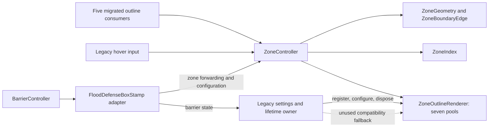

# ZoneSystem — Stage 5A: Legacy Dependency and Responsibility Audit

Audit date: 2026-10-20. Current saved source/assets are authoritative. Findings below are verified by source inspection, project searches and scene YAML parsing; proposed stages are future work only. The user reports prior Play Mode verification. No Unity execution or implementation was performed for this audit.

## 1. Executive summary

The legacy component cannot yet be removed. All five migrated consumers use ZoneController for outlines, but ZoneThinOutlineByHover still supplies hover input, renderer registration, appearance, barrier visibility policy and renderer disposal. Its file also declares two shared request structs. Five unused legacy fields retain ten serialized assignments across the two scenes. FloodDefenseBoxStamp already delegates zone queries; its remaining work concerns consumers, setup and barrier compatibility, rather than another geometry extraction.

Search scope: 6,922 C# files across Assets, Packages and cached package sources; serialized searches across Assets, including 56 scenes, 159 prefabs and 630 `.asset` files. Both primary scenes were parsed completely. All ZoneSystem sources, the full legacy outline/stamp scripts, BarrierController, related consumers, the original outline audit and Stage 1–4E records were inspected.

Important differences from historical reports: hover already uses ZoneController; the legacy renderer now has disposal; all five outline consumers have migrated; the old shelter scripts/components are absent. Neither the original audit's direct legacy calls nor its six-consumer count describes the current project.

## 2. Current ZoneSystem architecture

Paths used repeatedly below:

| Name | Exact source path |
| --- | --- |
| ZoneController | `Assets/Dev/Dev_ZoneSystem/Scripts/ZoneSystem/ZoneController.cs` |
| ZoneOutlineRenderer | `Assets/Dev/Dev_ZoneSystem/Scripts/ZoneSystem/ZoneOutlineRenderer.cs` |
| ZoneIndex | `Assets/Dev/Dev_ZoneSystem/Scripts/ZoneSystem/ZoneIndex.cs` |
| ZoneGeometry | `Assets/Dev/Dev_ZoneSystem/Scripts/ZoneSystem/ZoneGeometry.cs` |
| ZoneBoundaryEdge | `Assets/Dev/Dev_ZoneSystem/Scripts/ZoneSystem/ZoneBoundaryEdge.cs` |
| Legacy outline | `Assets/Dev/Scripts/Zones/ZoneThinOutlineByHover.cs` |
| Stamp | `Assets/Dev/Scripts/Flood/FloodDefenseBoxStamp.cs` |
| BarrierController | `Assets/Dev/Dev_BarrierSystem/Scripts/BarrierSystem/BarrierController.cs` |
| Loader | `Assets/Dev/Scripts/MapLoader/JsonMapLoader.cs` |

| Responsibility | Verified current owner / source | Proposed long-term owner |
| --- | --- | --- |
| Load JSON, paint terrain, populate grids/cell mapping | Loader `Awake`/`PaintFromJson`, lines 119–125, 165–203, 245–359 | Map-loading system; publish a readiness/reload contract separately if needed |
| Zone-index lifecycle/readiness | ZoneController `Configure`, `EnsureZoneIndexReadyForExternalUse`, `RebuildZoneIndex`, `InvalidateZoneIndex`, lines 45–99 | ZoneController with explicit map-lifecycle coordination |
| Index construction and lookups | ZoneIndex lines 21–158; ordinal GEOID dictionary and normalized-tile reverse lookup | ZoneIndex behind ZoneController |
| GEOID/world/tile queries and coordinate conversion | ZoneController lines 105–190; world lookup delegates to Loader | ZoneController; coordinate source remains the map |
| Boundary tiles/edges | ZoneGeometry lines 6–95; ZoneController lines 193–212 | ZoneGeometry behind ZoneController |
| Edge representation / simulation conversion | ZoneBoundaryEdge lines 16–46; padding at 38–40 | Zone data contract; padding remains a barrier compatibility concern |
| Outline validation, geometry preparation, routing | ZoneController lines 216–337, 340–378 | ZoneController |
| Pools, actual LineRenderers, material handling, visibility application | ZoneOutlineRenderer lines 47–79, 128–209, 218–325 | ZoneOutlineRenderer |
| Select renderer owner / prevent duplicates | ZoneController `TryRegisterOutlineRenderer`, lines 382–419 | ZoneController; migrate away from a legacy owner |
| Appearance and renderer lifetime | Legacy fields lines 37–44; registration/settings/destruction at 374–436 | Proposed ZoneController-owned renderer/settings, preserving the existing rendering root |
| Mouse/camera input and hovered-zone cache | Legacy `Update`, lines 105–143 | Proposed ZoneHoverInputController |
| Barrier mode, commit rules, preview and physics | BarrierController, especially lines 176–224, 279–410 | BarrierSystem |
| Decide when zone outlines are barrier-hidden | Legacy `Update`/`RefreshOutlineSettings`, lines 80–108, 411–426 | Separate hover policy from persistent visibility; route through ZoneController, using BarrierController state |
| Compatibility fields/methods and startup bridging | Stamp and legacy outline | Retire only after the corresponding consumers/setup are migrated |

ZoneIndex owns the sole zone lookup; the stamp does not maintain a second cache. Geometry is recomputed for requests, not cached as boundary lists. `IReadOnlyDictionary<string, HashSet<Vector2Int>>` protects the outer API shape but exposes mutable sets. `TryGetZoneTiles` also returns the actual mutable set.

## 3. ZoneThinOutlineByHover responsibility inventory

Categories: **A** already owned by ZoneController/ZoneOutlineRenderer; **B** move to ZoneHoverInputController; **C** move coordination/configuration into ZoneController; **D** remain with BarrierSystem; **E** obsolete compatibility behavior.

| Current responsibility | Evidence | Classification / retirement requirement |
| --- | --- | --- |
| Read mouse and project to world, force world Z to zero | `Update`, lines 114–115 | B; preserve current `Input.mousePosition` and camera semantics initially |
| Detect hovered zone | `TryGetZoneTilesAtWorld`, lines 120–124 | A for lookup; B for invoking it from input |
| Track GEOID and HashSet identity; commit cache only after successful drawing | lines 59–60, 126–143 | B; same-set in-place mutations do not invalidate this cache |
| Request Hover outline | `SetZoneOutline(Hover, ...)`, line 135 | A for geometry/rendering; B for request timing |
| Clear Hover and reset cache on miss/unready/barrier/disabled-hover conditions | `ClearOutline`, lines 439–444; callers in Update | B orchestration, A channel clear; do not clear persistent channels |
| Resolve camera and stamp | `Awake`, lines 62–70 | B for camera; stamp dependency is temporary until direct barrier-state wiring replaces it |
| Choose scene/map controller, register renderer, retry once | `RegisterOutlineRenderer`, lines 374–408; Start 73–77 | A duplicate protection; C initialization/ownership handoff |
| Store template/material/color/width/Z/sorting configuration | lines 37–44, 418–420 | C serialized configuration; A application to lines |
| Store hover enabled/visibility options | lines 46–53 | B hover option; C persistent visibility policy; preserve all flag combinations |
| Determine barrier-mode state | lines 91, 422, through stamp | D state ownership; current stamp property only forwards it |
| Hide/restore six persistent pools without clearing | lines 91–103, 447–449 | C policy/coordination; A renderer operation |
| Configure transient suppression whenever Update or a legacy show runs | `RefreshOutlineSettings`, lines 411–426 | C; keep transient suppression separate from the public persistent per-channel visibility mask |
| Unregister and dispose generated lines/material | `OnDestroy`, lines 429–436 | C lifetime ownership; A disposal implementation |
| Raw-set boundary calculation / stamp conversion | lines 146–169, 317–362 | E; no external caller remains |
| Legacy GEOID/tile show and clear adapters, early-map fallback | lines 172–306, 452–474, 477–545 | E after reference checks; successful forwarding already uses A |
| Declare shared request structs | lines 7–29 | C data ownership: extract into the ZoneSystem folder before deleting this script |

The script has no `OnEnable` or `OnDisable`. Disabling only the MonoBehaviour stops hover/policy polling but leaves registration, cached lines and generated children intact. Disabling its GameObject hides children through hierarchy state; destroying the component unregisters and disposes resources. A replacement must preserve or explicitly revise these distinct behaviors in a separately approved scope.

Only input, initialization/configuration, visibility coordination, and lifetime currently require the legacy MonoBehaviour. Boundary drawing and pooling have already moved. No UI-pointer exclusion is implemented; do not silently add one during input extraction.

## 4. Remaining C# consumers and dependencies

### Direct legacy-type consumers

All five rows are enabled and active in both saved primary scenes. Each field name appears only in its declaration: it is unused by executable behavior, but its type is still a compilation dependency. No row calls a legacy outline API or looks up ZoneThinOutlineByHover anymore.

| Exact file / class | Retained serialized field | Current gateway calls | Required dependency removal |
| --- | --- | --- | --- |
| `Assets/Dev/Scripts/Zones/HighRiskManager.cs` / HighRiskManager | `ZoneThinOutlineByHover zoneOutlineController`, line 18 | `ClearShownRiskZones`:203; `ShowRiskOutlines`:287, BaselineRisk | Remove field and its saved assignment in both scenes; preserve manager/labels/markers and the new controller reference |
| `Assets/Dev/Scripts/Flood/FloodImpactOverlayManager.cs` / FloodImpactOverlayManager | `zoneOutlineController`, line 15 | `HideLiveFloodOverlay`:164; `RenderLiveFloodOverlay`:270, LiveFloodRisk | Remove field plus both assignments; retain refresh/subscription/toggle behavior |
| `Assets/Game/Features/MitigationFeatures/Communication/CommunicationTowerController.cs` / CommunicationTowerController | `zoneVisualController`, line 76 | `ShowAssociatedZoneHighlight`:1075; `ClearHoveredTower`:1093 | Remove field plus both assignments; header line 7 is documentation only |
| `Assets/Dev/Dev_Shelter/Scripts/ShelterPresentation.cs` / ShelterPresentation | `zoneOutlineHighlighter`, line 16 | Set zones/tiles:185/188; paired clear:199–200; placed show/clear:257/266 | Remove field plus both assignments; preserve the three independent channel contracts |
| `Assets/Dev/Scripts/Zones/ZoneBaselineRiskController.cs` / ZoneBaselineRiskController | `zoneOutlineHighlighter`, line 70 | `HighlightHighRiskZones`:254; `ClearRiskHighlights`:268 | Remove field plus both assignments; preserve calculations, events and shared-baseline semantics |

These fields are behaviorally safe to retire now, **with explicit serialized-field cleanup**. Removing the legacy script while leaving the fields causes missing-type compilation errors. They cannot be type-renamed into ZoneController references: they point to a different component. The warning string in ZoneController line 334 also mentions the legacy class but is not a type dependency.

### Shared declarations that still block script deletion

`ZoneRiskOutlineRequest` is a global public struct with readonly `string Geoid` and `Color Color`, plus its existing constructor (legacy lines 7–17). It is used by all five consumers and ZoneController `SetZoneOutlines`. `TileOutlineRequest` is a global public struct with readonly `Vector3Int Cell` and `Color Color`, plus its constructor (lines 19–29); ShelterPresentation and ZoneController use it. Neither currently has `[Serializable]`. Preserve exact names, namespace, assembly, fields, modifiers, constructors and absence of extra attributes when extracting; do not duplicate declarations.

`ZoneOutlineChannel` already lives in `ZoneOutlineRenderer.cs:6–15`, independently of the legacy file. Actual helper references are confined to ZoneController, the legacy component and the helper itself. There are no external helper constructors or event subscriptions. ZoneController and these data/helpers declare no zone-readiness events.

### Other references to the requested types

The five outline consumers above account for all external channel/request uses. Remaining direct dependencies and indirect stamp consumers are:

| Exact file / class | Field, lookup, method parameter or event dependency | Saved scene status |
| --- | --- | --- |
| `Assets/Dev/Scripts/Flood/FloodImpactController.cs` | Stamp field:40, discovery:81/420; readiness/all zones:230/237/577/584; normalized conversion/terrain:466/507–508/591 | Active both |
| `Assets/Dev/Dev_Shelter/Scripts/ShelterController.cs` | Stamp field:13, discovery:690; zone lookup:608, terrain:699/772; barrier-mode exit:215–216 | Active both |
| `Assets/Dev/Dev_Shelter/Scripts/ShelterTypes.cs` / ShelterCandidateContext | Stamp-valued `FloodDefense`:95; terrain/readiness:113/134 | Plain context supplied by ShelterController |
| `Assets/Dev/Dev_Shelter/Scripts/ShelterCandidateResolver.cs` | Indirect context dependency: `_context.FloodDefense.GetAllZoneTiles`:191; conversions:541/760/779 | Plain service used by active controller |
| `Assets/Game/Features/MitigationFeatures/Evacuation/EvacuationController.cs` | Stamp field:72, lookup:911; terrain:914; zone queries:1260/1404; conversions/origin:1658/1664 | Active both |
| `Assets/Game/Features/MitigationFeatures/Communication/CommunicationTowerController.cs` | Stamp field:72, lookup:400; all zones:333; conversions:368/782; MapData:403; terrain:413; controller resolution:444–475 | Active both; outline migration did not remove its data dependency |
| `Assets/Dev/Scripts/Zones/ZoneBaselineRiskController.cs` | Stamp field:64, lookup:128; queries:393/534; terrain/readiness:669/697/703; conversions:876/905 | Active both; separate data dependency from the unused outline field |
| `Assets/Dev/Scripts/PanelController/ActionsPanelController.cs` | Stamp field:18; placement controls:113/133; discovery:123/243; mode event subscribe/unsubscribe:437/492; state:558 | Active both |
| `Assets/Dev/Scripts/Main_UI/UI_Controller_Scripts/PreparationCardsController.cs` | Stamp field:43; discovery:157/409; `EnablePlaceBarrierMode`:417 | No saved instance in PlayableTilemap; two inactive instances in Dev_UINavigation |
| `Assets/Game/Features/UI/Scripts/UI_Advisor_Scripts/AdvisorPanelController.cs` | Stamp field:20, discovery:237; `ZoneBarrierPlaced` subscribe/unsubscribe:261/302 | Active both |
| `Assets/Dev/Scripts/GameStateSummary/GameStateSummaryBuilder.cs` | Static `FloodDefenseBoxStamp.OnAllZoneBarriersPlaced` subscribe/unsubscribe:201/255 | Active both; no serialized stamp field |
| `Assets/Dev/Dev_BarrierSystem/Scripts/BarrierSystem/BarrierController.cs` | ZoneController field:19 and adapter configuration parameter:119; lookups/creation:511–528; readiness/rebuild and boundary APIs:492–508/340 | Active both |
| `Assets/Dev/Dev_BarrierSystem/Scripts/BarrierSystem/BarrierPlacementInput.cs` | ZoneController parameter:24; world lookup:39 | Active both |
| `Assets/Dev/Dev_BarrierSystem/Scripts/BarrierSystem/BarrierVisuals.cs` | ZoneController parameters:41/67; boundary tiles and normalized conversion:50/59/79/87 | Active both; Tilemap visuals are outside the seven line channels |
| `Assets/Dev/Dev_BarrierSystem/Scripts/BarrierSystem/BarrierPhysicsAdapter.cs` | ZoneController parameters:67/133; edge-to-water-cell conversion:196 | Active both |
| `Assets/Dev/Dev_Scripts/Editor/FloodImpactValidationWindow.cs` | ZoneController field:17, ObjectField/type:87–90, queries/conversion:290/479/581, discovery:594 | Editor-only; no scene component |
| `Assets/Game/Features/LegacyWaterSystem/WaterSimulator.cs` | Indirect serialized MonoBehaviour provider cast to IBarrierProvider:31–32/78–80; both scenes assign the stamp | Inactive root GameObject in both scenes; still serialized |

The legacy component itself remains the stamp's additional active consumer for barrier state and fallback geometry. Indirect UI paths also remain: `AdvisorMainController.cs:193–205` requests manager/fallback baseline display; `ScenarioIntroController.cs:102–109,193–205` hides it. Neither directly invokes legacy outline APIs.

## 5. FloodDefenseBoxStamp responsibility inventory

### A. Zone lookup / geometry and equivalent APIs

| Stamp member / line | ZoneController equivalent / line | Current difference to preserve |
| --- | --- | --- |
| `EnsureZoneIndexReadyForExternalUse`:275 | Same method:73 | Stamp first resolves/creates/configures the controller |
| `TryGetZoneTiles`:281 | Same method:105 | Same nonempty GEOID guard and shared mutable set; stamp first configures |
| `GetAllZoneTiles`:294 | Same method:122 | Same dictionary; stamp first configures |
| `TryGetZoneTilesAtWorld`:302 | Same method:130 | Same Loader-based hit and world Z=0; stamp first configures |
| `NormalizedTileToCell`:316 | Same method:160 | Stamp first configures; failure fallback returns `(x,y,0)` unchanged |
| `TileOrigin`:65 | `TileOrigin`:29 | Stamp returns zero when no controller; it does not ensure configuration for this property |
| `TerrainTilemap`:69 | `TerrainTilemap`:23 | Stamp falls back to its own serialized terrain when controller/terrain is missing |
| `MapData`:63 | No public map-data getter | Consumers must retain their own explicit TileMapData dependency; do not access ZoneIndex internals |

There is no remaining boundary-generation method in the stamp to extract. ZoneController additionally exposes `CellToNormalizedTile`, `TryGetGeoidAtNormalizedTile`, `ContainsTile`, `TryGetBoundaryTiles` and `TryGetBoundaryEdges`; new consumers should use these through the controller.

### B. Barrier placement, boundaries and mode

Stamp lines 47–61 forward placement counts/limits/state to BarrierController; lines 229–273 forward eight UI/mode methods; lines 324–351 implement the six IBarrierProvider queries by forwarding to BarrierController. These have no zone-query equivalent and belong to BarrierSystem or an explicitly retained compatibility adapter.

Stamp lines 186–226 relay instance mode/placement events and a **static** all-barriers event. BarrierController has corresponding instance events (`:10–12`, invocation at 402/409/612). Replacing the static event with an instance subscription changes event scope; migrate callers and scene selection deliberately.

Actual barrier placement already uses ZoneController: BarrierController `ZoneBoundaryUpdate`/`TryCommitZoneBoundaryBarrier` (`:279–410`) obtains a zone and its boundary edges, asks BarrierPhysicsAdapter to commit, records compatibility-grid state, paints BarrierVisuals, raises events and exits when appropriate. Keep its limits, water validation and commit ordering unchanged.

### C. Map/tile conversions and geometry contracts

- **Normalized tiles** are zero-based within the index's captured terrain origin. ZoneIndex `:91–123` subtracts `cellBounds.xMin/yMin`; GridSize is TileMapData.N, giving a square `N×N` index. A rectangular Loader map is clipped to that square. Current saved terrain is origin `(0,0)`, size `(64,64)` in both scenes; negative origins remain a supported conversion case to test, not a current saved value.
- **Absolute cells** add the captured origin through ZoneController `:160–172`. With origin `(-20,-10)`, normalized `(0,0)` means cell `(-20,-10,0)`. TileOutlineRequest.Cell is already absolute: never add the origin again.
- **World hits** use Loader.groundTilemap.WorldToCell and Loader.cellToRC (`Loader:448–465`), not a generic nearest-zone search. Loader must match the controller's terrain/map.
- **Edges** are unpadded grid lines: X extends vertically, Y horizontally. ZoneGeometry includes holes, external map edges and shared-zone seams; ZoneController draws each requested zone independently, including coincident shared seams. ZoneBoundaryEdge equality uses orientation/grid line, not its other metadata (`:43–46`).
- **Legacy simulation padding** is `GridLine+(1,1)` only (`ZoneBoundaryEdge:38–40`). BarrierPlacementState uses that for compatibility arrays (`:65–69,109–116`). In contrast, BarrierPhysicsAdapter skips map-exterior edges, converts interior grid lines to absolute cells, and calls WaterController (`:187–206`, `:89–93`). Visual outlines must retain exterior edges; do not reuse the physics filtering or padded coordinates for rendering.
- **GEOIDs** remain exact ordinal strings. ZoneIndex skips null/empty but does not trim; controller batch outline APIs reject whitespace-only identifiers without normalizing valid strings. The stamp forwards that contract. Shelter/communication normalize some inputs themselves; migration is not permission to change matching globally.

### D. Initialization and cache ownership

Stamp `Awake:73–95` configures ZoneController/BarrierController and forces barrier mode off. `EnsureZoneControllerConfigured:165–183` tries assignment, local component, unrestricted first-object lookup, then runtime creation, and calls `Configure` repeatedly. BarrierController has a similar path (`:511–528`). Unlike the outline component's registration search, these fallbacks are not restricted to the same scene/map.

`Configure` clears ZoneIndex only when the map/terrain/loader **references** change. Mutating an existing Loader's payload/grids or TileMapData.N does not invalidate it. No call site for `InvalidateZoneIndex` exists outside its declaration; the only external `RebuildZoneIndex` call is BarrierController's explicit build. Loader.PaintFromJson does not notify the zone controller. Direct-query migration must retain setup/readiness explicitly rather than accidentally removing the only configurator. Zone queries can lazily build the index; even `TileOrigin` compresses terrain bounds when the index is uninitialized (`ZoneController:29–41`). These are existing side effects, not purely passive getters.

Stamp has no zone geometry/cache of its own. Its OnEnable configures and subscribes to BarrierController; OnDisable exits barrier mode and unsubscribes (`:98–110`). Its hidden legacy settings are preservation fields, not the active barrier configuration (`PreserveLegacySerializedConfiguration:115–131`).

### E. Public compatibility surface and authored settings

The zone methods above can be replaced at their consumers after wiring a suitable ZoneController and preserving stronger map guards. Barrier controls/events/IBarrierProvider must remain until independently migrated.

Both scenes retain stale stamp settings different from the active BarrierController: stamp maximum 3 versus active 4; stamp seepage 0 versus active .001; preview/committed tiles and colors also differ. The active BarrierController owns its own preview/outline references and settings. `ConfigureReferencesFromLegacyAdapter:114–134` transfers references, not these hidden gameplay values. Never copy the hidden settings over the active settings during cleanup. Both force mode off during startup despite the active controller's serialized mode flag being true.

## 6. Scene/prefab serialization dependencies

Primary scene paths:

- **PT**: `Assets/Game/Content/Scenes/PlayableTilemap.unity`
- **DN**: `Assets/Dev/Dev_UINavigation/Scenes/Dev_UINavigation.unity`

Only these scenes contain the three relevant MonoBehaviour types. No other scene, prefab or serialized asset binding was found. Each listed component and its GameObject hierarchy is enabled/active in both saved scenes.

| Type | Script GUID | Component / GameObject fileID | Hierarchy | PT / DN record line |
| --- | --- | --- | --- | --- |
| ZoneThinOutlineByHover | `71bfc9ffc1b314ef7a54476c563601a5` | `704415076` / `704415074` | `Canvas/ZoneBoundaryLine` | 4084 / 4085 |
| FloodDefenseBoxStamp | `a99f55ae89eac4deca4c7d4c65418c4e` | `1046329326` / `1046329324` | `Systems/FloodController/FloodDefenseManager` | 5413 / 5413 |
| ZoneController | `32a2bd6974cc48f781edac70b6557993` | `2070746514` / `2070746513` | `Systems/ZoneSystem/ZoneController` | 80491 / 80659 |
| ZoneOutlineRenderer | `72e1e060271494970ae2fc4f63bbe816` | None | Plain internal IDisposable helper, not a MonoBehaviour | No binding |

Every scene retains these five references to `704415076`:

| Owner component / location | Serialized member |
| --- | --- |
| `434996198`, `Systems/ShelterSystem/ShelterPresentation` | `zoneOutlineHighlighter` |
| `810699005`, `Systems/CommunicationTower` | `zoneVisualController` |
| `1089964579`, `Systems/FloodController/FloodDamageUIManager` | `zoneOutlineController` |
| `1590100951`, `Systems/ZoneRisk/ZoneBaselineRisk` | `zoneOutlineHighlighter` |
| `1663569816`, `Systems/ZoneRisk/HighRiskZones` | `zoneOutlineController` |

The owning GameObject's component list also references it. No serialized UnityEvent calling a legacy outline method was found.

Stamp `1046329326` has eight active serialized consumers in each scene: FloodImpactController, EvacuationController, AdvisorPanelController, ZoneThinOutlineByHover, CommunicationTowerController, ActionsPanelController, ShelterController and ZoneBaselineRiskController. Its GameObject component list is an additional ownership reference. An inactive WaterSimulator component `1818902683` assigns it as `barrierProviderBehaviour` in both scenes. DN additionally retains two inactive PreparationCardsController assignments (`1819329177`, `2147339104`). GameStateSummaryBuilder's static event dependency is executable but not a scene reference.

Both BarrierController `420333452` and stamp explicitly reference ZoneController `2070746514` in both scenes. PT additionally assigns it to ShelterPresentation, CommunicationTowerController and FloodImpactOverlayManager. PT baseline has no serialized new field and HighRisk's new field is zero. DN's five migrated consumers have absent/zero new controller fields and rely on their initial resolution. All five still carry the old assignments; absence of a new YAML key means the new field starts null, not that Unity migrates the old reference.

Shared map wiring: TileMapData asset GUID `7e81a30567a6c1b44ae537c0db92678b`; terrain `1822120955`; Loader `1678446140`; camera `917516086`. Stamp references BarrierController `420333452` and WaterController `1876854016`.

**Appearance is still authored on the legacy component**, identically in both scenes: LineRenderer template `1963393216` on `Prefabs/ZoneLinePrefab`; material GUID `5c951169c35ea49eab614112f3848aa0` at `Assets/Dev/Ash_dev/ash_prefabs/ZoneLineMaterial.mat`; yellow RGBA `(1,.85,.15,1)`; width `.08` (source default `.045`); Z `-.1`; Default sorting layer/order 1000; outlining enabled and both barrier-hide flags true. The template is a saved scene LineRenderer reference, not a ZoneOutlineRenderer component. Preserve its assigned object and material asset identity.

ZoneController does not search for a renderer component. The legacy owner finds a matching controller in its scene, calls `TryRegisterOutlineRenderer(this, ...)`, and obtains the helper. Both retain the same helper reference; line children are parented under the legacy transform. Actual line width/material/sorting are configured when a pool entry is created; subsequent Show updates endpoints, Z and request colors. Moving settings must preserve this creation/reuse behavior.

Removing the legacy component now breaks **hover, all persistent channels, candidate tiles/zones, placed coverage, communication lines and barrier suppression**, because it unregisters/disposes the renderer. Data-only zone/barrier queries can still work. Removing only the script also removes the request structs, leaves five consumer fields with an unresolved type and two missing-script components, plus unresolved typed assignments. Preserving the original GameObject is essential when it becomes the new rendering root/input host.

## 7. Outline-channel ownership

All migrated consumer shows/updates/clears and normal hover requests pass through ZoneController. No external consumer invokes a legacy outline API. This does not mean every internal path uses the gateway: the legacy script's unused raw-set/early-initialization fallbacks call the helper directly, and its hover cleanup can clear the helper directly when the controller is unavailable (`ClearOutlineChannel:452–460`). Barrier preview/committed Tilemaps are a separate visual system and do not use these channels.

| Channel | Requester / show-update | Clear / lifecycle behavior |
| --- | --- | --- |
| Hover | Legacy `Update:120–143` → `SetZoneOutline` | `ClearOutline:439–444` on miss, missing readiness/camera/controller, hover disabled or barrier; no OnDisable clear |
| BaselineRisk | HighRiskManager `ShowBaselineRiskOverlay` → private `ShowRiskOutlines:262–291`; ZoneBaselineRiskController `HighlightHighRiskZones:235–262` → batch setter | HighRisk `ClearShownRiskZones:183–204`, including OnDisable:111–120; baseline `ClearRiskHighlights:265–269`. Baseline OnDisable only unsubscribes/stops its coroutine; it does not clear this channel |
| LiveFloodRisk | FloodImpactOverlayManager `ShowLiveFloodOverlay:146–155` / `RenderLiveFloodOverlay:230–275`; visible impact refresh handler:221–227 | `HideLiveFloodOverlay:158–165`; OnDisable:109–121 unsubscribes, unbinds and hides |
| ShelterCandidateZones | ShelterPresentation `ShowShelterCandidates:130–188` → batch setter | `ClearCandidateVisuals:195–200` clears this and candidate tiles; OnDisable:63–67 and ShelterController hide/exit paths call it |
| ShelterCandidateTiles | Same show method; absolute `result.tileCell`, lines 159/188 → tile setter | Same paired clear; placed coverage remains independent |
| PlacedShelterZones | ShelterPresentation `RefreshPlacedShelterZoneOutlines:212–260`, requested by ShelterController startup/placement/refresh | `ClearPlacedShelterZoneOutlines:263–266`; disabled coverage flag:221–224; both presentation and controller disable paths clear |
| CommunicationZones | CommunicationTowerController `ShowAssociatedZoneHighlight:1060–1080` | `ClearHoveredTower:1083–1095` on hover exit/mode hiding/disable; OnDisable:146–154 |

All seven pools/counts belong to the same ZoneOutlineRenderer (`:47–79`). Six non-Hover channels share persistent suppression. Explicit `SetOutlineVisibility` stores a per-channel requested mask, while `SetPersistentVisibility` temporarily hides/restores cached lines. These are not interchangeable APIs.

With saved flags `(true,true)`, barrier entry clears Hover and hides persistent lines without clearing their counts; exit restores current cached contents. Missing stamp hides all lines. Disabling hover or losing its camera suppresses Hover only. The nondefault `(false,true)` legacy quirk remains: Update does not hide on barrier entry; Show suppresses persistent lines, then a later Update may restore them. Do not silently fix this while extracting ownership/input.

**Shared BaselineRisk remains coupled.** Both writers replace the entire channel; last show wins and either clear removes the other's outlines. HighRiskManager can retain its visible flag/labels after a direct baseline-controller clear or replacement. Direct baseline highlighting bypasses manager-level baseline/live arbitration. HighRiskManager hides the live manager before showing (`:151–152`); the live manager hides HighRiskManager before showing (`:151–152`). These rules are consumer behavior, not channel ownership arbitration. There is no per-requester ownership token or automatic restoration of a previous baseline writer.

Gateway semantics to preserve: a failed single-zone request leaves the channel intact; ready null/empty batches clear it; unready setters do not queue or clear; clears require a renderer but not a ready map. Duplicate/shared zone edges are not globally deduplicated.

## 8. Initialization and lifecycle dependencies

This is a source-derived startup trace, not an observed runtime recording. Relative order among default-order scene components is not specified by their code; the Loader's `.cs.meta` explicitly sets execution order **100**. ZoneController has no Awake/Start/OnEnable initializer.

1. At scene creation, serialized ZoneController/stamp/barrier references exist. Default-order stamp Awake configures the controller and barrier; BarrierController Awake resolves child input/visual/physics components, initializes compatibility-grid state and forces mode off. Either can resolve/add missing components; saved scenes already supply them. Configuration does not build ZoneIndex.
2. Legacy outline Awake resolves camera/stamp and registers against the unique controller in the same scene whose terrain matches. This can succeed **before map data is ready** because registration needs neither Loader payload nor index. The helper is created once under the owner's transform, but actual LineRenderers are allocated only when requested. Start provides one bounded retry if registration failed.
3. Loader Awake at order 100 synchronously calls PaintFromJson, reading `StreamingAssets/tilemap_with_population_elev.json` in both scenes (no override), setting N, grids, cellToRC and terrain. At successful completion data is available before ordinary scene Start callbacks. Early Awake/OnEnable requests can legitimately fail before this point.
4. Queries lazily initialize ZoneIndex. ZoneBaselineRiskController Start waits for its stronger map-ready guard, then calculates (`:188–194,503–520`). Both scenes save `autoCalculateOnStart=1`, **`autoHighlightHighRiskOnStart=0`**, so calculation does not automatically display baseline lines. Communication's Start coroutine waits for generation prerequisites; ShelterController checks readiness on demand. A failed renderer request is not automatically replayed by ZoneController.
5. Hover Update queries through the controller when all its guards pass. User actions drive other overlays. PlayableTilemap also permits ScenarioIntroController's scene bootstrap/opening sequence, which calls HideBaselineRiskOverlay (`:32–85,102–109`); Advisor inspection later requests HighRiskManager or baseline fallback. This affects display timing, not data ownership. Saved active flags do not prove that a particular overlay is currently visible.

Important lifecycle limits:

- Legacy registration is attempted in Awake and at most once in Start. It is not retried each Update or OnEnable. A controller appearing after both attempts is not automatically bound. A missing stamp found only after owner Awake is not automatically discovered by Update either; only unused compatibility show paths retry stamp discovery.
- Five migrated consumers resolve during Awake; ShelterPresentation's repeated ResolveReferences calls deliberately guard its lookup after the first attempt. HighRisk/live fallback searches are scene-local but do not explicitly reject disabled MonoBehaviours on active GameObjects. Baseline/communication/shelter do. None continuously discovers replacement controllers. Late activation works when its initial Awake can see a suitable controller; re-enabling does not rerun Awake.
- Scene-local registration rejects multiple matching controllers and a second live outline owner. DisallowMultipleComponent prevents two controllers on one GameObject, not in a scene. Stamp/BarrierController unrestricted lookup/runtime creation can select the wrong additive scene or produce extra controllers on different GameObjects. Saved scenes have one each; duplicate risk is conditional, not a verified existing duplicate.
- Disabling ZoneController does not clear/dispose/unregister anything; public methods still execute. Its OnDestroy only drops renderer references (`:431–435`). The surviving old owner retains the helper but hover stops because its controller is gone; there is no automatic re-registration to a replacement.
- The owner remains registered when disabled; renderer availability checks owner existence, not `isActiveAndEnabled`. Removing it destroys all generated line objects and owned fallback material. Assigned assets survive. A never-active destroyed owner is cleaned up when a new registration detects the stale Unity reference (`ZoneController:391–398`).
- Loader readiness tests payload, nonempty cellToRC and geoidGrid; the controller also needs map/terrain references. They do not validate N>0 or catGrid/popGrid. World lookup and baseline/shelter calculations have stronger assumptions. A successfully built empty index remains initialized and Ensure does not rebuild it until invalidated/explicitly rebuilt.
- Repainting/mutating an existing map does not invalidate the index or retained line endpoints. Rebuild changes HashSet identity so hover can redraw, but persistent channels do not retain GEOID requests for automatic reconstruction. In-place set mutations do not invalidate hover's identity cache and can disagree with the reverse lookup. Any reload/read-only-contract improvements need their own stage.

## 9. Remaining compatibility APIs

All 19 public legacy signatures remain, with no external C# or serialized-event caller found:

- `ShowPersistentZoneOutlines(IEnumerable<HashSet<Vector2Int>>, Color)` (`:146`): direct raw normalized sets, same renderer.
- Baseline aliases: `ShowPersistentZoneOutlinesByGeoid` (`:172`), `ShowOutlineForZone` (`:177`), both `ShowRiskOutlines` overloads (`:182/192`), `ShowRiskOutlineForZone` (`:187`), `ShowBaselineRiskOutlines` (`:197`), `ClearPersistentZoneOutlines` (`:219`), `ClearRiskOutlines` (`:224`), `ClearBaselineRiskOutlines` (`:229`).
- Live show/clear (`:208/234`); candidate zone/tile show and paired clear (`:239/250/271`); placed show/clear (`:277/288`); communication show/clear (`:293/304`).

GEOID/tile adapters try the gateway first and retain old direct-renderer fallback behavior when rejected (`:250–268,463–524`). New consumers do not use that fallback. It can eventually disappear with the adapter, after shared-type extraction and ownership/input transfer.

Stamp compatibility includes the zone forwarding members in section 5, all barrier UI aliases, three relayed events and IBarrierProvider (`Assets/Dev/Scripts/Flood/Interface/IBarrierProvider.cs`). Keep it independently of the outline component until those dependencies are addressed. The mutable zone-query compatibility return types are also still used; retiring the outline does not make those data APIs removable.

## 10. Proposed incremental migration stages

These are proposals, not changes made or permission to change assets outside this audit. New C# files would receive new Unity metadata; preserve all existing component GUIDs until an explicit component-retirement stage. **PT/DN always mean the exact paths in section 6.** Each stage also writes its own AgentRef report.

| Proposed stage / objective | Exact likely files | Prerequisites / risks | Play Mode checks and completion criteria |
| --- | --- | --- | --- |
| **5B — Extract shared request contracts** | Legacy outline; new `Assets/Dev/Dev_ZoneSystem/Scripts/ZoneSystem/ZoneRiskOutlineRequest.cs` and `TileOutlineRequest.cs`, matching new `.meta` files | No consumer/API changes. Preserve global namespace, Assembly-CSharp membership, readonly fields and constructors; avoid duplicate definitions | Import/compile; all seven channels and absolute candidate cells unchanged. Exactly one declaration each; old component GUID/scenes unchanged |
| **5C — Remove unused typed consumer fields** | The five exact consumer files in section 4 and PT/DN; perform one consumer at a time | 5B recommended. Remove only that old field and its two saved assignments; never repurpose it as ZoneController. Keep old component rendering | Exercise that consumer, disable/re-enable, and compare its new controller assignment/resolution. Complete when no external C# type field or serialized consumer assignment remains |
| **5D — Transfer renderer/configuration ownership** | ZoneController, legacy outline, ZoneOutlineRenderer if necessary; PT/DN | 5B; 5C reduces ambiguity. Proposed controller owns the helper/lifetime and appearance; retain current `Canvas/ZoneBoundaryLine` transform as an explicit rendering root. Preserve registration guards and a single helper. Old OnDestroy must not dispose the transferred renderer. Expose transient policy coordination without changing requested visibility masks | All seven channels, growing/reused pools, template/material/width/Z/sorting, owner/gateway destruction and both disable modes. Complete when destroying the old component no longer removes persistent rendering resources; no duplicate renderer/lines |
| **5E — Extract hover input and visibility coordination** | New `Assets/Dev/Dev_ZoneSystem/Scripts/ZoneSystem/ZoneHoverInputController.cs`/meta; legacy outline; ZoneController for the smallest policy API; PT/DN | 5D. Move camera/mouse/GEOID-cache/hover-clear behavior; copy authored hover color/flags explicitly. One active hover driver only. Barrier state remains BarrierSystem's; initially preserve current state access and flag truth table. Do not substitute per-channel requested masks for transient hiding | Hover/miss/map-unready/negative origin; camera loss; all four barrier flag combinations; persistent show/clear while hidden; re-enable. Complete when old Update/input/policy is unnecessary and seven channels retain behavior |
| **5F — Retire legacy scene components** | PT/DN only | 5B–5E, no remaining consumers/serialized calls. Preserve GameObject/rendering root and new input component; remove component `704415076` and its list entry in each scene | Reload both scenes, check Console/wiring; hover, candidates/placed, risk/live, communication, barriers, startup. Complete: zero old component bindings, no dangling refs, same active behavior |
| **5G — Delete legacy script pair** | `Assets/Dev/Scripts/Zones/ZoneThinOutlineByHover.cs` and `.meta` only | 5F plus fresh global type/GUID searches; both request structs already independent. Diagnostic text is not a compile dependency | Compile and repeat both-scene smoke checks. Complete: no old script/GUID bindings/types; no other source or assets changed |

Complete outline retirement does **not** require mixing in all stamp consumers. Continue the following data stages separately, one requester at a time. Each retains its existing calculations and map guards, adds/resolves a suitable ZoneController where necessary, and explicitly wires new scene fields rather than converting stamp references by type:

| Proposed stage / objective | Exact likely files | Dependencies / risks | Tests / completion |
| --- | --- | --- | --- |
| **5H1 — Flood impact zone access** | `Assets/Dev/Scripts/Flood/FloodImpactController.cs`, PT/DN | Preserve TileMapData/WaterController readiness, absolute water-depth sampling and baseline dependencies | Compare per-zone risk/depth/damage results and live refresh; no zone data access through stamp |
| **5H2 — Baseline zone access** | `Assets/Dev/Scripts/Zones/ZoneBaselineRiskController.cs`, PT/DN | Preserve stronger population/category/N checks and mitigation; do not change shared-channel ownership | Compare original/adjusted risk, centroids, highlights and startup; calculations match without stamp zone methods |
| **5H3 — Communication zone access** | `Assets/Game/Features/MitigationFeatures/Communication/CommunicationTowerController.cs`, PT/DN | Retain explicit TileMapData because controller has no MapData API; preserve tower placement and terrain selection | Same tower locations/statuses/associated zones and hover outlines; data queries/conversion no longer use stamp |
| **5H4 — Evacuation zone access** | `Assets/Game/Features/MitigationFeatures/Evacuation/EvacuationController.cs`, PT/DN | Coordinate origin currently goes through stamp, including inverse conversion; preserve route map | Same route endpoints, validity/selection and mitigation for interior/exterior zones and negative origins; zone access uses controller |
| **5H5 — Shelter zone access** | `Assets/Dev/Dev_Shelter/Scripts/ShelterController.cs`, `ShelterTypes.cs`, `ShelterCandidateResolver.cs`, PT/DN | Cohesive context-contract migration; retain separate barrier-mode action until controls migrate | Compare candidate grouping, suitability, coordinates, placement, capacity/mitigation, coverage and turn events; no stamp zone queries in the three files |

H stages use existing ZoneController query APIs; source changes should not be required in ZoneIndex/ZoneGeometry/ZoneBoundaryEdge. If a missing map-data/setup API is discovered, stop that consumer stage and propose the smallest separate prerequisite instead of reaching into helpers.

| Later adapter stage / objective | Exact likely files | Dependencies / risks | Tests / completion |
| --- | --- | --- | --- |
| **5I1 — Barrier controls/state consumers** | `Assets/Dev/Scripts/PanelController/ActionsPanelController.cs`; `Assets/Dev/Scripts/Main_UI/UI_Controller_Scripts/PreparationCardsController.cs`; ShelterController; proposed ZoneHoverInputController; PT/DN | Direct BarrierController mode/configured references; preserve dormant preparation UI assignments. Keep cache hide/restore rules unchanged | Place Barriers, toggle/Escape/limits, shelter-mode exclusion and both UI flows; no stamp controls/state calls |
| **5I2 — Barrier event consumers** | `Assets/Game/Features/UI/Scripts/UI_Advisor_Scripts/AdvisorPanelController.cs`; `Assets/Dev/Scripts/GameStateSummary/GameStateSummaryBuilder.cs`; PT/DN | Instance events differ from stamp's static all-barriers relay; choose scene-scoped references explicitly and balance subscriptions | One Advisor/summary update per event, no callbacks while disabled, additive-scene scope checked; no stamp event subscriptions |
| **5I3 — Remove stamp setup/provider dependence** | Stamp; BarrierController; `Assets/Dev/Scripts/Flood/Interface/IBarrierProvider.cs` only if necessary; `Assets/Game/Features/LegacyWaterSystem/WaterSimulator.cs` only if an approved provider migration requires it; PT/DN | H/I consumer stages done. Barrier/map initialization must work without stamp Awake. Decide whether to retain dormant legacy water provider wiring or explicitly retire/rebind it. Preserve **active** barrier configuration, not hidden stamp settings | Start with stamp disabled/absent; barrier physics/preview/limits and water adapters work, no extra controllers created. Complete: zero setup/provider requirement on stamp |
| **5J — Retire stamp bindings, then script** | First PT/DN; only in a subsequent deletion step Stamp `.cs`/`.meta` | All above dependencies cleared; fresh type/GUID/interface searches, including inactive components. Stamp retirement is not a prerequisite for 5F/5G | Each step independently compiles and passes both-scene placement/flood/Advisor/summary checks; no dangling assignments, original active settings unchanged |

Readiness/reload notifications, immutable zone-query APIs, fixing the nondefault visibility quirk, UI-pointer filtering and BaselineRisk ownership arbitration are **separate optional behavior changes**, not prerequisites to remove the old outline component. Do not bundle them into extraction stages.

## 11. Risks and unresolved questions

| Finding / uncertainty | Implication and exact verification |
| --- | --- |
| Renderer ownership remains critical despite migrated callers | Destroy/remove the component only after a controlled ownership handoff; inspect helper identity/line counts and test every channel in PT/DN |
| Shared request declarations still live in the old file | Deleting it prematurely causes CS0246 in controller/consumers; 5B removes this compile dependency without changing behavior |
| Saved data is not an observed runtime trace | Unsaved Inspector edits, dynamically created objects, activation changes or additive scenes can differ. Check actual assigned controller/owner, hierarchy states and Console in Play Mode; audit did not execute Unity |
| Persistent baseline ownership is shared | Reproduce manager show → baseline show/clear → manager hide, then live toggle; expect last-writer/any-clear behavior unless a separate redesign is approved |
| One-shot scene-local resolvers versus unrestricted stamp fallbacks | Test late-created/late-enabled controllers, duplicate matching maps and additive scene load/unload. Explicit assignment avoids discovery ambiguity, but does not supply a renderer owner |
| Readiness and reload contracts are incomplete | Repaint same Loader object, rebuild explicitly, then check index count, hover cache and persistent endpoints. Decide later whether reload is supported and who reissues channels |
| Legacy visibility/lifecycle behavior is unusual | Test component disable separately from GameObject disable and destruction; retain masks, hidden caches, and `(false,true)` behavior during extraction |
| Stamp contains stale hidden configuration | Active maximum 4/seepage .001 and current visuals are authoritative; compare Inspector values before adapter retirement and never restore hidden maximum 3/seepage 0 by accident |
| Dormant provider and preparation components still serialize dependencies | Inactivity does not remove them. Inspect both WaterSimulator assignments and both DN PreparationCardsController instances before stamp deletion |
| Scope of future C# or asset edits | This audit authorizes none. New script identities need fresh metadata; component removal requires owning-list/reference cleanup; never reuse old script GUIDs for replacement classes |

No compilation, Play Mode run, source changes, component edits or fixes were performed for Stage 5A. Source searches and scene parsing establish the saved dependency map; they do not establish future runtime visual parity.

## 12. Recommended immediate next stage

**Stage 5B: extract ZoneRiskOutlineRequest and TileOutlineRequest into two dedicated files under `Assets/Dev/Dev_ZoneSystem/Scripts/ZoneSystem/`.** Remove only their declarations from the legacy file, retain its MonoBehaviour/GUID and every consumer unchanged, create normal new metadata, and compile/check uniqueness. This is the smallest independent prerequisite and matches the successful shared-data ownership approach used for ShelterSystem.

Then retire the five unused serialized fields deliberately, transfer renderer ownership/configuration, extract hover/policy, and remove the legacy scene components before deleting the script. Keep stamp data-query and BarrierSystem compatibility work in separately testable stages.
